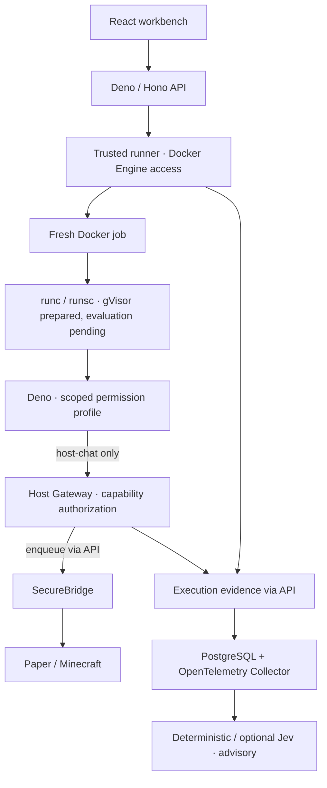

# Defense-in-Depth Script Host

A work-in-progress Bachelor Research Project investigating dynamically loaded,
untrusted JavaScript/TypeScript executed outside an active host application.
It combines Deno permissions, Docker isolation, prepared gVisor integration, a
restricted Host Gateway and SecureBridge/Paper host, PostgreSQL/OpenTelemetry
evidence, and deterministic/optional Jev advisory analysis. Minecraft/Paper is
the active-host proof of concept; the research concerns defense-in-depth.

## Why this project exists

AI-generated or dynamically loaded scripts may need to interact with a running
application. Executing them directly introduces risks. This PoC investigates how
independent layers can restrict, observe and analyse those scripts, reduce their
authority, and limit blast radius.

## Architecture



Non-host profiles have no network; `host-chat` uses a dedicated internal network.
Only the trusted runner mounts the Docker socket. PostgreSQL stores evidence;
the collector receives best-effort telemetry and currently uses a debug exporter.

## What currently works

| Component | Implemented behavior |
|---|---|
| React/Vite workbench + Deno/Hono API | Scripts, conversations, execution output/timeline, settings, SSE |
| PostgreSQL | Migrations, saved scripts, execution/security evidence |
| Docker/Deno runner | Real JS/TS execution in fresh jobs; scoped profiles; CPU/memory/PID/time/output restrictions |
| Evidence | Deno permission access/check auditing, execution manifests, host events, OTLP traces |
| Host Gateway + SecureBridge | Execution-scoped capability tokens, bounded `chat.broadcast`, Paper delivery |
| Risk analysis | Deterministic LOW / REVIEW / HIGH; optional Jev provider adapter and comparison tooling |
| Assistant | Mock by default; optional Gemini or OpenAI |

These are code capabilities, not proof that every isolation property has been
empirically established. Permission audit observations alone do not prove allow/deny.

## Current limitations / work still planned

| Feature | Current state | Why it matters |
|---|---|---|
| Jev evaluation | Adapter exists; successful empirical comparison incomplete | Establish usefulness against the deterministic baseline |
| gVisor | Runtime selection/preflight prepared; Linux/runsc evaluation pending | Compare an additional kernel isolation layer |
| Richer Host API | Sandbox capability is intentionally limited to chat broadcast | Explore useful interaction with narrow application authorization |
| Final analysis | Experimental comparisons and conclusions in progress | Measure limitations rather than infer guarantees |
| Public deployment | No production hardening or multi-user API authentication | Keep this stack on a trusted local development machine |

## Security model

- **Deno** reduces runtime authority through centrally defined permission profiles.
- **Docker** restricts process resources, network and filesystem access.
- **gVisor** is an optional additional kernel isolation layer awaiting evaluation.
- **Host Gateway** authorizes application capabilities independently of Deno network access.
- **SecureBridge** is the trusted adapter between the API command queue and Paper/Minecraft.
- **PostgreSQL/OpenTelemetry** preserve evidence and support reconstruction.
- **Deterministic/Jev analysis** supplies advisory metadata and never grants permissions.

Use a disposable local development environment. Published ports bind on all host
interfaces by default; restrict access with local firewall/network settings. The
runner's Docker Engine access is highly privileged. See [SECURITY.md](SECURITY.md).

## Quick start

**This is an active research PoC. Setup and reproducibility instructions are
still being refined.** This setup path is based on the current development
environment; complete disposable clean-clone verification has not been performed.


### Requirements

Git and Docker with Compose v2 using Linux containers. Docker builds supply
Node 22, Deno (API/runner 2.1.4; sandbox 2.9.7), Gradle 8.11.1/JDK 21,
PostgreSQL 16, and nginx; local Node, Deno, Java and Gradle are not required.
Node.js 18+ is optional for the root npm helper/research scripts. A matching
Minecraft Java Edition client is needed only to join Paper.

### 1. Clone and configure

Once you have access to the repository:

```bash
git clone https://github.com/Maciej-Mitura/ResearchProject_Hoatloading_Scripts.git
cd ResearchProject_Hoatloading_Scripts
cp .env.example .env
```

PowerShell: use `Copy-Item .env.example .env` for the last command.

Edit `.env`: replace `BRIDGE_TOKEN` and `HOST_GATEWAY_ADMIN_TOKEN` with independent
random local values. `POSTGRES_PASSWORD=poc` is a disposable local example;
configure your own value before retaining real data. Compose builds the database
URL from `POSTGRES_*`; setting `DATABASE_URL` in `.env` does not override it.

No external API key is required. Keep `CHAT_PROVIDER=mock` and
`RISK_ANALYZER=deterministic`. Set `EXECUTION_PROVIDER=docker` for real execution;
the default `mock` simulates runs without executing source. Optional provider
keys may remain blank. [.env.example](.env.example) documents supported settings,
including which advanced variables require service-specific overrides.

### 2. Start the workbench

```bash
docker compose up -d --build web
docker compose ps
```

This starts web, API, PostgreSQL, collector, runner and Host Gateway, and builds
the one-shot sandbox image. It omits Paper and its builder. Images/dependencies
need network downloads on first build; no paid AI calls are needed.

Open [the workbench](http://localhost:5173) and
[API health](http://localhost:3000/health). Check
[public configuration](http://localhost:3000/api/config/public) for the selected
execution provider. Docker execution fails clearly if the runner is unavailable.

### 3. Optional: start the Minecraft host

Read and accept the Minecraft EULA yourself before setting `EULA=TRUE` in `.env`.
Then:

```bash
docker compose up -d --build paper
docker compose logs -f paper
```

The one-shot Gradle builder writes SecureBridge into a shared plugin volume.
Paper downloads on first start. Wait for “Done”, then join `localhost:25565`
with Minecraft Java Edition **1.21.1** (or your configured `MC_VERSION`).
`ONLINE_MODE=false` is a local testing default; do not expose it as a public server.
Check [host status](http://localhost:3000/api/host/status) for `connected: true`.
To start everything together after accepting the EULA: `docker compose up -d --build`.

### 4. Stop or reset

```bash
docker compose down
# Destructive: deletes database, Minecraft world and plugin volumes:
docker compose down -v
```

For diagnostics: `docker compose logs --tail=100 api runner host-gateway paper`.
Root helpers `npm run dev:build`, `npm run stop` and `npm run logs` wrap Compose.

## Basic usage

Project Settings describe security intent; runtime Deno profiles are enforced by
the trusted runner. Changing UI intent does not grant runtime permissions.


1. Open the workbench and create/select a script; save its version.
2. Choose a profile and run it with Docker execution enabled.
3. Inspect stdout/stderr, permission activity, timeline and advisory risk results.
4. For host interaction, start Paper and select `host-chat`; inspect host delivery too.

| Profile | Authority added |
|---|---|
| `none` | No Deno allow flags; no job network |
| `read-fixture` | Read only the baked-in `/fixtures` directory |
| `env-demo` | Read a harmless supervisor-supplied demo environment variable |
| `host-chat` | Reach the gateway and request bounded `chat.broadcast` calls |

```js
console.log("Hello from the sandbox");
```

With `host-chat` and Paper connected:

```js
import { host } from "host";
await host.chat.broadcast("Hello from the sandbox");
```

## Validation and research status

| Area | Status |
|---|---|
| Core execution / Deno / Docker / Host Gateway | Implemented; development evidence and tests exist, complete clean-clone validation pending |
| Deterministic risk baseline | Implemented |
| Jev integration | Implemented; empirical evaluation in progress |
| gVisor | Prepared; Linux/runsc comparison pending |
| Final analysis | In progress |

The [publication review](docs/PUBLICATION-REVIEW.md) records checks already run,
their limits, and follow-up container test commands. No complete clean-clone
validation or successful Jev evaluation is claimed.

See [research boundaries](docs/RESEARCH-BOUNDARIES.md),
[Host Gateway](docs/HOST-GATEWAY.md),
[execution evidence](docs/EXECUTION-EVIDENCE.md),
[deterministic baseline](docs/DETERMINISTIC-RISK-BASELINE.md),
[Jev comparison](docs/JEV-RISK-COMPARISON.md), and [gVisor](docs/GVISOR.md).
Frozen evidence is intentionally not shipped in a clean clone; full reproduction
of the original frozen comparison requires the separately retained evidence.
Live Jev comparison commands can incur charges; they are not part of quick start.

## Feedback wanted

This work-in-progress Bachelor Research Project is being shared specifically for
technical community feedback. We welcome review of untrusted-code execution and
sandbox design, Deno permissions, Docker isolation, gVisor, capability-based host
APIs, OpenTelemetry/security evidence, and advisory risk analysis—especially
missing threat scenarios, architecture weaknesses and experimental methodology. Use repository issues for non-sensitive feedback; follow
[SECURITY.md](SECURITY.md) for suspected vulnerabilities.
