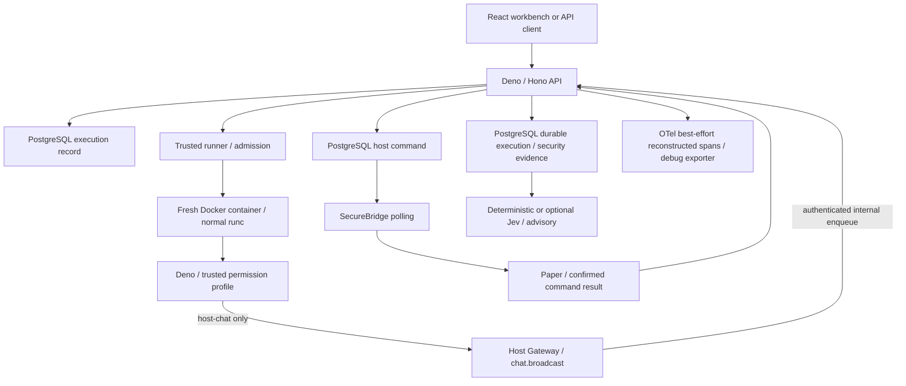

# Defense-in-Depth Script Host

A Bachelor research PoC investigating how layered runtime restrictions, narrow
host capabilities, execution evidence and advisory analysis support dynamically
loaded untrusted JavaScript/TypeScript outside an active application.
Minecraft/Paper is the demonstration host, not the research subject.

## Current architecture



Only the trusted runner has Docker Engine access. Scripts select a known profile,
not Docker commands or raw permission flags. Normal demos use **Docker + runc**.
The separate Linux/WSL experiment compared runc with runsc/gVisor; runsc is not
required and its unchanged DNS behavior failed the host-chat workload.

## What works and what it means

- Deno runs stored arbitrary JS/TS once, with real scoped permission enforcement.
- Docker jobs have inspected non-root, read-only root, dropped capabilities,
  no-new-privileges and CPU/memory/PID controls; timeout/output bounds and
  single-runner admission/recovery were demonstrated.
- Only `host.chat.broadcast` is available to sandbox scripts, through an
  execution-scoped Host Gateway session. Accepted means queued; Paper confirmation
  is a separate result. Status/player views are backend-only.
- PostgreSQL retains execution, security, command correlation and advisory records.
  UI timelines are reconstructed from those records. OTel is observability,
  not enforcement; the collector debug exporter is not durable trace storage.
- Assistant Project Settings guide generation. They do not grant runtime authority.
  Select an execution profile at Run and inspect its manifest/evidence afterward.
- Risk classification is advisory: REVIEW does not block execution; analysis can
  fail while execution completes. LOW does not mean safe, HIGH does not prove malice.

Persistent events, arbitrary Paper APIs, production end-user authentication,
distributed scheduling and gVisor escape prevention are not implemented or proven.
See [security boundaries](SECURITY.md) and the [33-claim evidence matrix](research-results/phase5-final-validation/2026-11-09T15-24-05Z/security-claim-matrix.md).

## Run the normal demo

Requires Git, Docker with Compose v2/Linux containers, network access for builds,
and access to the current integrated source. Docker supplies Node, Deno, Java,
Gradle, PostgreSQL and nginx; local language toolchains are optional.

```bash
git clone https://github.com/Maciej-Mitura/ResearchProject_Hoatloading_Scripts.git
cd ResearchProject_Hoatloading_Scripts
cp .env.example .env
```

PowerShell: `Copy-Item .env.example .env`. Important: Phases 1–6 are currently
uncommitted; published HEAD alone does not contain the validated integrated state.
Use the supplied working-tree snapshot until the planned source publication.

Generate **three independent private random secrets** of at least 32 characters
for `BRIDGE_TOKEN`, `HOST_GATEWAY_ADMIN_TOKEN`, `HOST_GATEWAY_SERVICE_TOKEN`, and
set a private URL-safe `POSTGRES_PASSWORD`. See [setup](docs/REPRODUCTION.md) for
PowerShell generation. Never copy real values into documentation or Git.
Set these non-secret settings in `.env`:

```env
EXECUTION_PROVIDER=docker
CHAT_PROVIDER=mock
RISK_ANALYZER=deterministic
SANDBOX_DOCKER_RUNTIME=
```

`CHAT_PROVIDER=mock` above deliberately selects the offline research/demo assistant. For real generative assistance, retain `CHAT_PROVIDER=gemini` with the existing ignored `GEMINI_API_KEY` and `GEMINI_MODEL`, or explicitly select the already supported OpenAI provider with its matching configuration. Do not overwrite your normal real-provider selection when following an offline demo. Missing/invalid assistant configuration is reported as unavailable; real-provider failures never produce mock answers.

The explicit mock execution option in `.env.example` only simulates source; it is
not the normal validated demo. No AI key, provider call or runsc is needed.

```bash
docker compose up -d --build web
docker compose ps
```

Default [workbench](http://localhost:5173), [health](http://localhost:3000/health),
and [public configuration](http://localhost:3000/api/config/public).
Use configured `WEB_PORT`/`API_PORT` when different; web must be rebuilt if
`VITE_API_URL` changes. Published ports bind all interfaces by default: keep this
local research service on a trusted development network.

For the host demo, read/accept the Minecraft EULA yourself, then set `EULA=TRUE`:

```bash
docker compose up -d --build paper
docker compose logs --tail=100 paper
```

Compose builds SecureBridge into the shared plugin volume and starts Paper.
Wait for Paper's “Done” and [host status](http://localhost:3000/api/host/status)
`connected: true`. Minecraft Java Edition 1.21.1 is optional to see the message
in-game. `ONLINE_MODE=false` is a local testing setting, not public-server setup.

```ts
import { host } from "host";
console.log(JSON.stringify(await host.chat.broadcast("Hello from the sandbox")));
```

Run with `host-chat`, then inspect correlated Paper confirmation in Server Info.
The [five samples](samples/README.md), [short demo runbook](docs/DEMO-RUNBOOK.md),
and [reproduction instructions](docs/REPRODUCTION.md) cover the full flow.
Stop with `docker compose stop`; no volume reset is needed.

## Empirical status

| Area | Completed controlled finding |
|---|---|
| Core integration | Phase 5 E1–E8, real Paper effect, capacity/security/outage checks and fresh-data setup passed; 217 tests passed |
| Deterministic v1 | 24/25 agreement with researcher reference labels; HOL-008 blind spot retained |
| Jev 1.14.0 | 125 primary classifications; 16/25 modal reference agreement; 23/25 unanimous; no improvement over deterministic reference agreement |
| gVisor | 100 measured attested runs; 9/10 workloads compatible; W8 DNS failure; workload/environment-specific median ratios about 1.62–2.61x |
| OTel | Collector receipt and one outage/recovery demonstrated; late Paper ack remains DB evidence; no durable trace backend |

See [current research status](docs/RESEARCH-STATUS.md) for exact packages and limits.
These are bounded measurements, not general detector accuracy or escape-prevention
proof. Phase 7 interpretation has not begun. Original failures/negative findings
remain preserved. Phase 5 validated fresh data from the working tree, not published
HEAD or an offline/no-cache build.

## Tests and further reading

[Reproduction/test commands](docs/REPRODUCTION.md#tests) cover API, runner, gateway,
frontend, PostgreSQL, Docker and Java suites. Normal demo validation never requires
rerunning paid Jev evaluation or the gVisor benchmark.

- [Architecture](docs/ARCHITECTURE.md)
- [Host Gateway](docs/HOST-GATEWAY.md)
- [Project context](docs/PROJECT-CONTEXT.md)
- [Execution evidence](docs/EXECUTION-EVIDENCE.md)
- [OpenTelemetry](docs/OTEL-EXECUTION-RECONSTRUCTION.md)
- [Deterministic baseline](docs/DETERMINISTIC-RISK-BASELINE.md)
- [Jev](docs/JEV-RISK-COMPARISON.md) and [gVisor](docs/GVISOR.md)

Frozen evidence is currently retained locally, partly ignored/untracked; source
publication and result packaging require explicit review, not blanket `git add`.
See the Phase 6 publication checklist. Report suspected vulnerabilities privately
as described in [SECURITY.md](SECURITY.md); repository issues are for non-sensitive feedback.

## Post-analysis capability extension

Per-script capability manifests were added as a post-analysis extension and were not part of the frozen Phase 1–7 empirical experiments. New saved versions require explicit review before using `host-capabilities`; historical profiles remain available for historical versions. See [capability manifests](docs/CAPABILITY-MANIFESTS.md) for the four typed operations, review flow and enforcement limits. Phase 8 has not started.


## Post-analysis one-shot platform extension

Expanded host capabilities and multi-file script support are post-analysis extensions. They were not part of the frozen Phase 1–7 research experiments. See [one-shot project architecture and user guide](docs/ADVANCED-SCRIPT-PLATFORM.md). Workbench now supports real file tabs and a **What are the limits?** guide; Execution Insights queries date ranges across scripts with pagination. Persistent event listeners and arbitrary server commands remain unsupported.
