# Runlattice – volledig technisch dossier

Nederlandstalige beschrijving van de huidige werkboom en de lokale runtime, met de bevroren experimenten afzonderlijk geduid. Exacte technische namen blijven behouden. De lezer heeft geen repositorytoegang nodig voor de inhoudelijke uitleg. De bronpaden dienen voor controle.

## Leeswijzer

1. Project en hoofdonderzoeksvraag
2. Architectuur, Compose en installatie
3. Vertrouwen, defense-in-depth en autorisatie
4. Uitvoering, voortgang en technisch bewijs
5. Capability-manifests en actuele registry
6. UI-inventaris
7. PostgreSQL-inventaris
8. HTTP-inventaris
9. Configuratiereferentie
10. Onderzoeksresultaten en verdediging
11. Implementatie tegenover bevroren onderzoek
12. Beperkingen, verificatiegrenzen en toekomstwerk
13. Demonstratieplan voor 5–10 minuten
14. Vragen voor de mondelinge verdediging
15. Begrippenlijst
16. Dependency-audit
17. Issues discovered during dossier inspection
18. Bronindex en verificatiestatus
19. Aanvullende bronverificatie

## 1. Project en hoofdonderzoeksvraag

Runlattice is een lokale werkbank waarmee een gebruiker JavaScript of TypeScript kan schrijven, opslaan en eenmalig uitvoeren. Een vertrouwde runner start daarvoor een tijdelijke Deno-container. Standaard kan een script rekenen en tekst afdrukken. Een script met Minecraft-functionaliteit gebruikt de Host SDK. Een aparte Host Gateway controleert de bevoegdheid voordat SecureBridge een beperkte Paper-operatie uitvoert. De werkbank toont het uitvoeringsresultaat, verzamelde observaties en een afzonderlijke risicobeoordeling. Gemini kan scripts en capability-aanvragen voorstellen. De gebruiker beoordeelt die aanvragen per opgeslagen versie.

**In één zin.** Runlattice voert onbetrouwbare scripts uit in een tijdelijke sandbox en koppelt toegestane Minecraft-acties aan controleerbare records.

> In welke mate kan een defense-in-depth architectuur met Deno-permissies, gVisor-isolatie, Jev-gebaseerde risicoanalyse en OpenTelemetry-observability risico's detecteren, isoleren en beperken bij het uitvoeren van dynamisch geladen, onbetrouwbare TypeScript-scripts die via een beperkte API interageren met een actieve hostapplicatie?

Letterlijk uit `research-results/phase7-analysis/2026-11-09T18-02-24Z/research-question.md`. Daar is de Phase 7-opdracht als bron genoemd. Actuele officiële deelvragen zijn daar niet bevestigd. Detecteren betekent observeerbaar gedrag registreren en interpreteren. Isoleren betekent grenzen trekken tussen job, Docker-host en Minecraft. Beperken betekent bevoegdheden, looptijd en resources begrenzen. Defense-in-depth betekent dat die maatregelen verschillende verantwoordelijkheden dragen.

### Identiteit van de inspectie

Repository `C:/Users/mimac.DESKTOP-OQT5HDD/Desktop/RP_Hotload_Script/ResearchProject_Hoatloading_Scripts`. Branch `master`, HEAD `23f7e66a6f6e2ed171d9d6fe36fe32e87e12c09f`. Start 11 november 2026 om 15:17:36 UTC. Dirty tree met 96 gewijzigde en 2 verwijderde tracked bestanden, plus 1.826 untracked bestanden vóór het dossier. Die delta bevat zowel onderzoeksmateriaal als latere wijzigingen. De post-research lagen zijn herkenbaar in manifests, multi-file, het uitgebreide SDK/registry, de herstelde Assistant en het Runlattice-frontend. De telling omvat meer dan deze lagen en kent geen exacte fase toe aan elk gewijzigd bestand.

Docker Desktop-context `desktop-linux`, Engine 28.1.1, Compose v2.35.1-desktop.1. Web op 15173, API op 13000, Paper op 25565. Publieke config meldde `docker`, `deterministic`, `gemini`, `gemini-3.8-flash` en `configured`. Web en SecureBridge hebben versie 0.1.0 in hun projectmetadata. Runlattice is de zichtbare merknaam. Bewijsniveaus in dit dossier zijn broncode, read-only runtime-waarneming en gedateerd historisch experiment.

## 2. Architectuur, Compose en installatie

| Component | Technologie | Vertrouwen | Verantwoordelijkheid en verbinding |
|---|---|---|---|
| Web | React, Vite, nginx, CodeMirror 6 | Interface, invoer onbetrouwbaar | Stuurt versies, reviews en run-aanvragen naar API en projecteert opgeslagen bewijs |
| API | Deno, Hono | Vertrouwde applicatielaag | Valideert, beheert versies/records, stuurt runner, biedt Bridge-protocol aan |
| PostgreSQL | postgres:16-alpine | Vertrouwde opslag | Duurzame applicatierecords voor API |
| Runner | Deno/Hono, Docker Engine | Hoog vertrouwd | Eigenaar Docker-socket, capaciteit en volledige job-lifecycle |
| Sandbox | Docker, Deno 2.9.7 | Vertrouwde image en entrypoint, onbetrouwbare usercode | Voert tijdelijke job uit, standaard zonder netwerk |
| Host Gateway | Deno/Hono | Vertrouwde autorisatie | Apart capability- en adminpad, controleert jobbevoegdheid, vraagt API om commando |
| Capability-session | In-memory Gateway-state | Vertrouwde context, token beperkt gedelegeerd | Bindt calls aan uitvoering, authority, peer en tijd |
| SecureBridge | Java 21, Gradle, Paper-plugin | Vertrouwde adapter | Vraagt opdrachten op bij API, voert toegelaten Bukkit-acties uit en rapporteert resultaten |
| Paper | Minecraft Java, Paper 1.21.1 standaard | Vertrouwde host | Houdt Minecraft-wereld en spelers bij |
| OTel Collector | OpenTelemetry 0.114.0 | Operationele observatie | Ontvangt API-spans via OTLP |
| Deterministisch | TypeScript-rules | Advies | Interpreteert gestructureerd uitvoeringsbewijs |
| Jev | TypeSafe of Vercel-provider | Externe adviesbron | Classificeert getransformeerde evidence, optioneel |
| Gemini | Google-provider, API server-side | Onbetrouwbare inhoud | Levert tekst en voorstellen, verwerft geen hostbevoegdheid |
| runsc | Optionele gVisor OCI-runtime | Extra runtimegrens | Alternatief bij correct geconfigureerde Linux Engine |

| Compose-service | Build/image | Netwerk | Hostpoort standaard → waargenomen | Startafhankelijkheid |
|---|---|---|---|---|
| web | apps/web/Dockerfile | internal | 5173 → 15173 | API gezond |
| api | apps/api/Dockerfile | internal | 3000 → 13000 | PostgreSQL gezond, collector/runner gestart, sandbox-build klaar |
| postgres | postgres:16-alpine | internal | geen | geen |
| otel-collector | otel/opentelemetry-collector:0.114.0 | internal | geen | geen |
| runner | services/runner/Dockerfile | internal | geen, intern 3100 | sandbox klaar en Gateway gestart |
| host-gateway | services/host-gateway/Dockerfile | internal + sandbox-host | geen, 3200 en 3201 intern | geen harde Compose-afhankelijkheid |
| sandbox | services/sandbox/Dockerfile | buildservice in internal | geen | one-shot die image beschikbaar maakt |
| bridge-builder | minecraft/bridge/Dockerfile | internal | geen | one-shot, schrijft pluginvolume |
| paper | itzg/minecraft-server:java21 | internal | 25565 → 25565 | bridge-builder klaar, API gezond |

`internal` is de applicatiebridge, `sandbox-host` is een afzonderlijke bridge met `internal: true`. De gewone job gebruikt `none`. De Gateway biedt op 3200 het capability-pad aan. Het adminpad bindt aan de alias `host-gateway-admin` op de applicatiebridge, poort 3201. API, PostgreSQL, Paper en runner zitten buiten het jobnetwerk. Gepubliceerde poorten binden in de waargenomen Compose-status aan `0.0.0.0`. Dat is een belangrijk PoC-deploymentkenmerk.

Gebruik Git, Docker Desktop of Linux Engine met Linux-containers en Compose v2. Node is nuttig voor lokale frontendontwikkeling, Deno voor losse API-/servicetests en JDK 21 voor lokale plugintests. Docker-builds verzorgen die runtimes voor de gewone stack. Minecraft Java-client is optioneel voor zichtbaar spelgedrag. Paper vereist aanvaarding van de EULA. Een afzonderlijke Linux-Engine met geregistreerde `runsc` is optioneel. Azure, cloudhosting en een APK zijn niet vereist. Externe modelproviders vereisen alleen bij gebruik een passend account en een sleutel. Zie `compose.yaml`, `README.md`, `docs/RESTORE-LOCAL-SETUP.md` en `docs/REPRODUCTION.md`.

### Architectuur

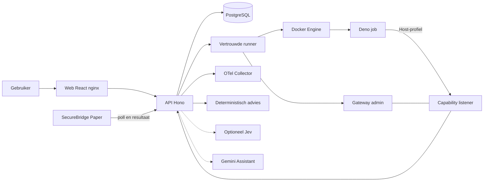

### Architectuur voor presentatie

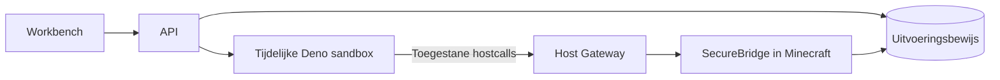

### Compose-netwerken

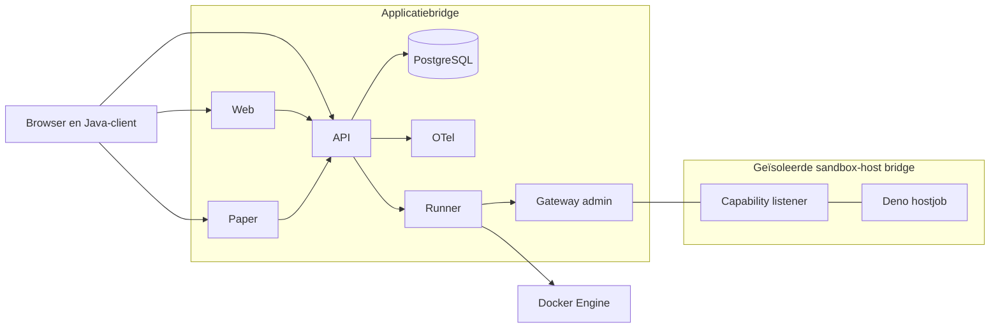

## 3. Vertrouwen, defense-in-depth en autorisatie

| Laag | Soort | Beschermt en waarom | Grens |
|---|---|---|---|
| Deno-profielen | Handhaving | Beperken read, env, net, subprocess, write, FFI tot vertrouwde grants | Een geconfigureerde grant blijft mogelijk en procesfouten blijven mogelijk |
| Docker | Handhaving | Job krijgt eigen container, procesgrens, read-only root en minimale privileges | runc deelt de hostkernel. Een container is geen bewezen ondoordringbare grens |
| Runner-limieten | Handhaving | Tijd, CPU, geheugen, PIDs, output en gelijktijdige jobs zijn begrensd | Geen algemene garantie voor meergebruikerscapaciteit of alle storingen |
| gVisor/runsc | Optionele handhaving | Extra syscall- en kernelabstractie | Onderzoek meet compatibiliteit, timing en geselecteerde controls |
| Host Gateway | Handhaving | Controleert identiteit, scope, TTL, quota en argumenten, vóór enqueue | Een goedgekeurd effect kan nog verkeerd gekozen zijn en Paper kan het afwijzen |
| Manifest/review | Autorisatie-input | Legt vast wat de gebruiker voor deze versie toestaat | Een voorstel of keuze in de UI handhaaft op zichzelf niets |
| PostgreSQL | Duurzaam bewijs | Bewaart resultaten, gebeurtenissen, reviews en correlatie | Geeft geen volledige reconstructie van onwaargenomen gedrag |
| OpenTelemetry | Observability | Geeft timing en reconstructie tussen vertrouwde records | Export kan wegvallen. Geen autorisatie of duurzame bron |
| Deterministisch/Jev | Advies | Labelt beschikbaar gestructureerd bewijs | Wijzigt geen Deno-grants, Gateway-autoriteit of procesuitkomst |

Gemini, Gemini-code, usercode en voorgestelde manifests zijn onbetrouwbare invoer. Validatie kan de vorm van een voorstel bevestigen. Een gebruiker besluit over een versie en de Gateway handhaaft de opgeslagen scope. Een browser kan binnen dit lokale PoC een review indienen via de UI/API. De backend toetst die review aan de gevraagde bevoegdheden. De browser kan geen willekeurige ongevraagde capability, Docker-image, mounts, runtimeflags of directe Gateway-adminrechten meegeven. Deze lokale API heeft geen productie-identiteitsmodel. De runner is de enige Compose-service met de Docker-socket. Jobcontainers krijgen de socket niet en hebben geen rechtstreekse netwerkroute naar Paper of PostgreSQL.

Een Host SDK-call is JSON-verkeer met execution-credential naar de capability listener. De runner maakt en bindt de Gateway-session via het adminpad. De Gateway controleert sessie, peer, uitvoering, authority, constraints en tellers. De runner trekt de sessie in bij afhandeling. TTL is standaard 40 s en de Gateway-config vermeldt maximaal 120 s. De job kan de Gateway bereiken met het hostprofiel. Een niet-goedgekeurde `world.setBlock` blijft afgewezen met `CAPABILITY_NOT_APPROVED`. De Bridge-token, admin-token en Gateway-service-token zijn onafhankelijk. Providersleutels blijven API-side. Een capability-token is tijdelijk en geldt alleen binnen die sessie. Dit zijn PoC-servicecredentials, geen gebruikersaccounts.

SecureBridge draait in Paper. Het haalt opdrachten op via het Bridge-pad, houdt heartbeat bij en meldt resultaat terug. `CommandExecutor` dispatcht een vaste enum en gebruikt Bukkit/Paper-methoden. Er is geen generieke uitvoerder voor consolecommando's of Java-reflectie. Bij hosttraces betekent REQUESTED een vastgelegde aanvraag, AUTHORIZED een Gateway-besluit, QUEUED een geaccepteerde enqueue en CONFIRMED een gekoppeld Paper-resultaat. DELIVERED is afgeleid uit de opgeslagen overgang/resultaatcorrelatie. Een zelfstandig deliverytijdstip volgt daar niet uit.

Bronnen `compose.yaml`, `services/runner/src/docker.ts`, `services/host-gateway/src/{main,sessions,manifest-calls}.ts`, `apps/api/src/routes/{host,internal}.ts`, `apps/web/src/host-evidence.ts`, `minecraft/bridge/src/main/java/be/research/securebridge/CommandExecutor.java`.

### Vertrouwensgrenzen

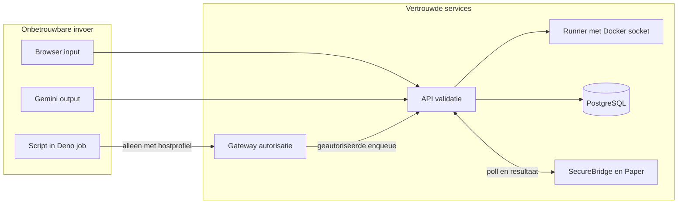

### Deno Docker en gVisor

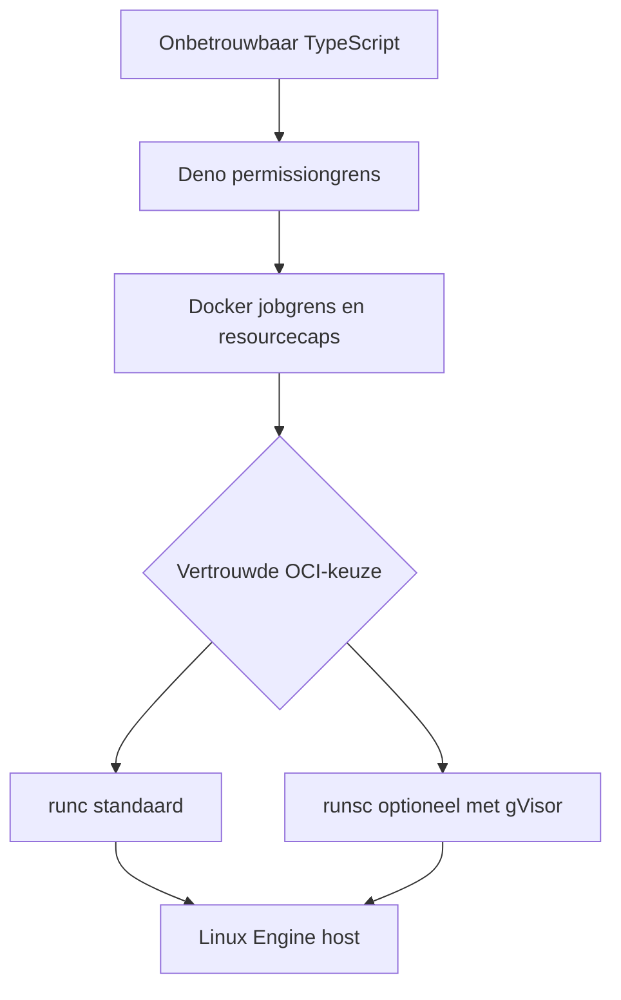

### Gateway naar Paper

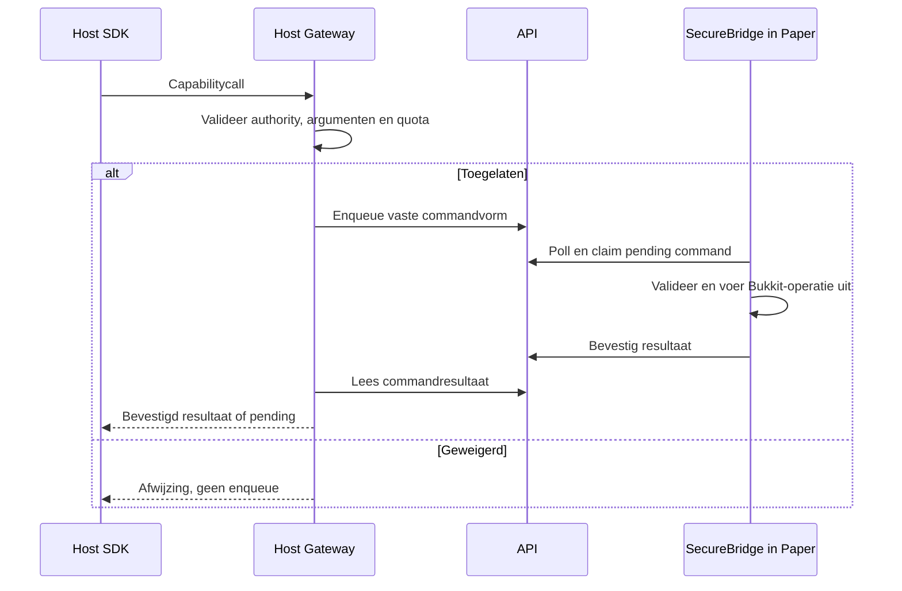

## 4. Uitvoering, voortgang en technisch bewijs

1. Workbench selecteert een opgeslagen scriptversie en een profiel. Vuile bron wordt eerst opgeslagen. `POST /api/executions` verwacht `scriptId`, optioneel `scriptVersionId` en `permissionProfile`. Onbekende profielen en ruwe permission- en Docker-opties worden geweigerd.
2. `ExecutionService.start` in `apps/api/src/services/mock-execution.ts` valideert de versie en maakt een record. Voor manifestmodus bouwt de API een versiegebonden execution-authority op. Ontbrekende vereiste review of keuze voor legacy host-chat bij een manifestversie wordt vóór de recordaanmaak afgewezen en de route retourneert HTTP 400.
3. API retourneert het record met HTTP 201 na de synchrone startvalidatie. De eigenlijke job en advisory-afhandeling lopen asynchroon. De Docker-provider stuurt de opgeslagen snapshot naar de supervisor via `POST /execute`. Mock is een gesimuleerde provider.
4. De runner valideert de aanvraag, reserveert lokaal capaciteit en configureert een verse container. Vol betekent supervisor-HTTP 429, zonder wachtrij. Het frontend heeft al een apart API-record en ziet de uitkomst via dat record. Bij onzekere cleanup blijft capaciteit behouden totdat de runner herstel kan bevestigen. Zie `admission.ts`, `docker.ts` en `main.ts`.
5. De sandbox materialiseert de geselecteerde snapshot met `materialize.ts` in zijn tijdelijke workspace. `entrypoint.sh` start Deno zonder permissieprompts. De runner beheert capture, wall-time, inspectie en cleanup. Met hostprofiel krijgt deze job een tijdelijke Gateway-sessie.
6. De runner retourneert processtatus, begrensde stdout/stderr, duur, auditstatus en runtimegegevens. De container wordt opgeruimd. API schrijft resultaat en observaties in PostgreSQL, gevolgd door afzonderlijke advisory-analyse op de beschikbare records. Een analysefout blijft een analysefout.
7. `useExecutionMonitor` leest record en gebeurtenissen via polling, typisch om de 3 s. De API heeft tevens een events-SSE-route. De werkbank toont meteen een verzendstatus en verstreken tijd. De UI toont geen percentage of bewezen container-starttijd als alleen een API-status bekend is. Na terminale status kan een begrensde extra refresh late evidence/advisory ophalen. Een laadfout heeft retry met backoff.

### Runtimewaarden en profielen

Standaard Deno 2.9.7, UID/GID 1993:1993, vaste image `research-poc-sandbox:local`. Configuratie gebruikt 0,5 CPU, 256 MiB geheugen en begrensde swap, 64 PIDs, `--read-only`, tmpfs 64 MiB voor workspace en 16 MiB voor tmp, alle capabilities gedropt, no-new-privileges, 10.000 ms wall-time en 1.048.576 bytes output. Auditbudget 200 observaties en 65.536 bytes. Twee actieve jobs per runner. Configuratie is bronaudit. Fasen 2, 4 en 5 bevatten afzonderlijke gedragsproeven voor geselecteerde controls. De Deno audit logt access/check, stdout blijft scripttekst.

| Profiel-ID | UI / API-label | Grants | Voorbeeld |
|---|---|---|---|
| none | No permissions | Geen runtimegrants, netwerk none | console.log(2 + 2) |
| read-fixture | Read test fixture | Alleen lezen binnen /fixtures, netwerk none | Lees baked-in fixture |
| env-demo | Demo environment in Workbench / Demo environment variable in public config | Alleen SANDBOX_DEMO_VALUE, netwerk none | Log de demowaarde |
| host-chat | Chat broadcast (fixed) in de tooltip / Chat broadcast in public config | SDK-read, beperkte env en netwerk naar Gateway, vaste legacy-chatgrant, alleen historische versies zonder manifest | Serverbrede demo-aankondiging |
| host-capabilities | Per-script permissions / Approved host capabilities | Dezelfde smalle SDK-transportgrants, authority uit de opgeslagen review | server.status na review |

Geen profiel geeft algemeen bestands-, netwerk-, subprocess-, schrijf- of FFI-recht. Statische moduleloading van opgeslagen lokale modules is iets anders dan willekeurige `Deno.readTextFile`-toegang. Het vertrouwde importmap maakt `host` beschikbaar in de hostprofielen.

### Uitkomst, fouten en provenance

`completed` betekent normale procesuitkomst. `failed` kan een onopgevangen scriptfout of infrastructurele fout betekenen. `terminated` wordt onder meer gebruikt voor de wall-time stop. `blocked` gaat over een geweigerde start. API-statussen zoals `validating` en `running` hebben de betekenis van het API-record. `ExecutionFeedback.tsx` projecteert Request, Process, Result, Evidence, Assessment op basis van beschikbare gegevens. `execution-errors.ts` maakt onder andere host-SDK/importfouten, syntax/runtimefouten, permissieweigering, ontbrekende module, timeout en infrastructuur leesbaar. Output wordt begrensd en voor weergave ontdaan van ANSI/control sequences. Een herkende bronlocatie kan het overeenkomstige bestand en regel in de editor openen. De ruwe opgeslagen uitkomst blijft behouden.

Runner `frames.ts` onderscheidt scriptstdout van de vertrouwde audit-/runtimeframes. Het resultaat bewaart een exitcode indien beschikbaar, truncatie en een foutcategorie. De runner redigeert bekende execution-credentials in de vastgelegde uitvoer. Afwezigheid van een frame of een capturelimiet wordt expliciet als collectieconditie behandeld. Een gebruikersbericht dat op een diagnostische melding lijkt, krijgt daarmee geen bronprovenance. Bron `services/runner/src/{frames,output,docker,audit-collection}.ts`.

Bij een oneindige lus grijpt de wall-time deadline in. Eerdere stdout kan reeds in de buffer staan. `job_wall_timeout` verklaart de stop. `missing_audit_frame` zegt dat de verwachte terugmelding van de audit ontbreekt. Termination kan een HIGH-regel voeden. Dat label staat los van bewijsbeschikbaarheid en procesuitkomst. Het bekeken record toont 10.440 ms gemeten duur rond een geconfigureerde grens van 10 s.

| Term | Betekenis | Voorbeeld |
|---|---|---|
| complete | Collectie eindigde volgens de collectiecriteria | Een geldige audit kan nul records hebben |
| partial | Slechts deel van de waarnemingen bruikbaar | Event- of bytecap |
| unavailable | Geen bruikbare verzameling | Ontbrekend auditframe na timeout |
| legacy_unknown | Oud record mist actuele collectieprovenance | Historische onderzoekscorpusrecords |
| Observed | Ondersteund door vertrouwd record | Opgeslagen Paper-antwoord |
| Inferred | Afgeleid uit gerelateerde records | Delivery uit gekoppeld commandresultaat |
| Not recorded | Benodigd record ontbreekt | Onafhankelijk deliverytijdstip |
| Not applicable | Stap was niet relevant | Hostpad bij pure console-run |
| Configured | Ingestelde waarde | Verwachte Deno-versie uit runnerconfig |

Een native auditobservatie bewijst geen allow/deny-beslissing voor die individuele toegang. Volledige collectie garandeert alleen de status van het collectieproces. Een niet-geregistreerde poging zoals HOL-008 kan onzichtbaar blijven.

Bronnen `apps/api/src/routes/executions.ts`, `apps/api/src/services/mock-execution.ts`, `services/runner/src/{config,permissions,admission,docker,audit-collection}.ts`, `services/sandbox/{Dockerfile,entrypoint.sh,materialize.ts}`, `apps/web/src/{execution-errors,execution-ux,useExecutionMonitor}.ts`.

### Uitvoeringsflow

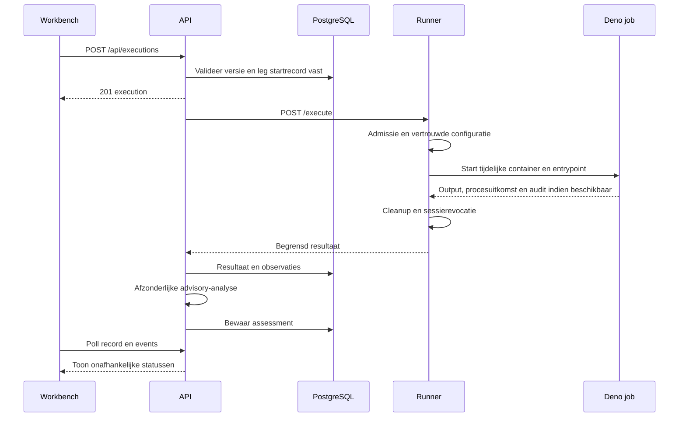

### Uitvoering voor presentatie

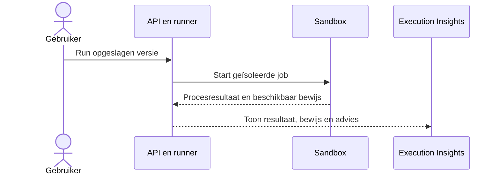

### Timeout en audit

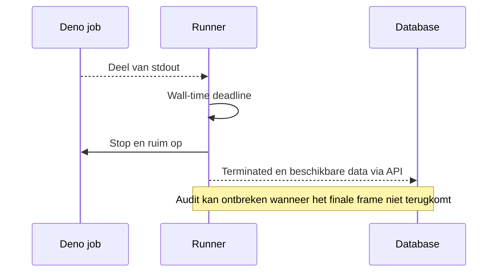

### Bewijs en advies

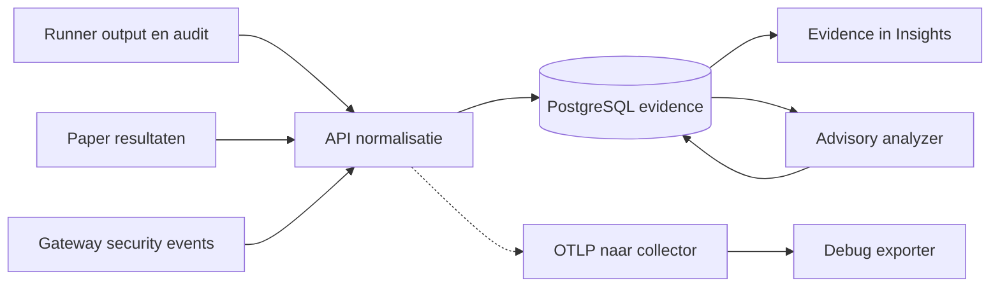

## 5. Capability-manifests en actuele registry

`packages/contracts/src/capabilities.ts` is leidend. Het API-endpoint `GET /api/scripts/capabilities/registry` levert de registry en een gegenereerde resource spiegelt de toegelaten waarden voor Paper. Alle registry-entries hebben versie 1. `parseRequests` valideert maximaal 16 unieke requests, een reden van maximaal 500 tekens, required-flag en beperkte constraints. Een onbekende capability kan als waarschuwing in het voorstel bestaan. Die kan geen autoriteit krijgen.

Gemini kan bij een voorstel bestanden, entrypoint en `requestedCapabilities` aanleveren. Een review heeft per gevraagde capability een expliciete beslissing. Alleen de opgeslagen goedgekeurde subset wordt execution-authority. Een gedeeltelijke goedkeuring verleent alleen de gekozen subset. Bronverwijzingen naar geweigerde capabilities kunnen blijven staan. De Gateway weigert zulke calls. Een nieuw opgeslagen snapshot krijgt geen automatische overdracht van review. `sourceSha256` bindt bron of canonieke projectbundel aan de versie. Constraint-sets kunnen een subset opleggen van toegelaten spelers, materialen, weer, tijden, sounds en entiteiten. Effectieve quota zijn begrensd door registry en review. Het manifestpad telt maximaal 12 geldige aanvragen over de sessie en controleert vervolgens per-capabilityquota. Het legacy-chatbudget staat afzonderlijk op standaard 5.

| ID | Max | Argumenten | Output / Paper-dispatch | Voorbeeld na review |
|---|---:|---|---|---|
| chat.broadcast | 5 | bericht | broadcast_message, ontvangst via hostpad | `await host.chat.broadcast("Demo")` |
| server.status | 3 | geen | capability_status, spelersaantal, maximum, versie, demoLocation | `await host.server.status()` |
| player.sendMessage | 5 | naam, bericht | send_player_message, resultaatstatus | `await host.player.sendMessage("Speler", "Hallo")` |
| player.getState | 3 | naam | player_state, naam, XYZ, yaw, pitch, wereld | `await host.player.getState("Speler")` |
| world.getBlock | 5 | gehele XYZ | get_block, type/positie | `await host.world.getBlock({x,y,z})` |
| world.setBlock | 5 | gehele XYZ, type | set_block, type, vorig type en positie | `await host.world.setBlock({x,y,z,type:"STONE"})` |
| world.setWeather | 1 | weather | set_weather, preset en wereld | `await host.world.setWeather("CLEAR")` |
| world.setTime | 1 | time | set_time, preset en ticks | `await host.world.setTime("DAY")` |
| world.playSound | 3 | XYZ, sound | play_sound, sound-ID | `await host.world.playSound({x,y,z,sound:"BLOCK_NOTE_BLOCK_PLING"})` |
| world.spawnEntity | 3 | XYZ, type | spawn_entity, entity-ID, type, positie | `await host.world.spawnEntity({x,y,z,type:"PIG"})` |

Voorbeelden gebruiken waarden uit een geldige demo-positie. Leesacties zoals `getState`, `status` en `getBlock` verwachten bevestigde data. Andere SDK-acties geven het resultaatobject van het transport terug. Zie `services/sandbox/host/{mod,call,chat}.ts`.

- Entiteiten `ZOMBIE`, `SKELETON`, `COW`, `PIG`.
- Materialen `STONE`, `DIRT`, `GRASS_BLOCK`, `COBBLESTONE`, `OAK_PLANKS`, `GLASS`, `GOLD_BLOCK`, `DIAMOND_ORE`, `AIR`.
- Weer `CLEAR`, `RAIN`, `THUNDER`. Paper stelt de duur in op 1.200 ticks.
- Tijd `DAY` 1000, `NOON` 6000, `SUNSET` 12000, `NIGHT` 18000.
- Sounds `ENTITY_ZOMBIE_AMBIENT`, `BLOCK_NOTE_BLOCK_PLING`, `ENTITY_EXPERIENCE_ORB_PICKUP`. Vaste volume/pitch 0,5 / 1,0.
- Locatieacties in de eerste Bukkit-wereld. Maximaal 32 blokken afwijking op elke horizontale as, van spawn-Y−8 tot spawn-Y+16 binnen de werkelijke wereldhoogte, alleen geladen chunks. Contractfilter bewaakt tevens numeriek domein, onder meer Y −64 tot 320. Dit beperkt de impact en vermijdt geforceerd laden.
- Spelers moeten exact vindbaar en online zijn. Berichten zijn begrensd tot 256 tekens in het standaardpad, zonder lege tekst, ongewenste controltekens of formatteringscode. Spelersnamen volgen 1–16 alfanumerieke tekens of underscore. De state-interface geeft beperkte positionele data, geen NBT.
- Bedrock en `TileState` kunnen niet vervangen worden. Er is geen container- of NBT-interface.

`import { host } from "host"` komt via de vertrouwde importmap uit de sandboximage. Het is geen npm-package. Elk lokaal projectbestand kan dezelfde bare import gebruiken onder een hostprofiel. De gebruiker kan eigen wrappers schrijven, maar daarmee verandert de Gateway-autoriteit niet. Onder `none` ontbreekt de Host SDK-importmap. De runtime laadt de vaste SDK onder `/trusted/host` en API-aanroepen gaan als JSON naar de Gateway.

Bronnen `packages/contracts/src/capabilities.ts`, `services/host-gateway/src/{main,manifest-calls,sessions}.ts`, `apps/api/src/routes/{scripts,internal}.ts`, `services/sandbox/{import_map.json,host}`, `minecraft/bridge/src/main/java/be/research/securebridge/{CommandExecutor,CapabilityArguments,HostCommandType}.java`.

### Capability-goedkeuring

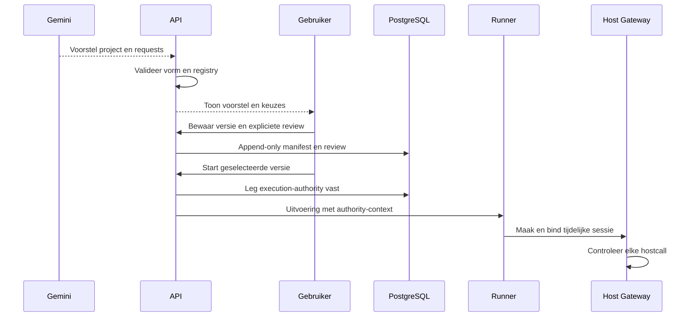

### Goedkeuring voor presentatie

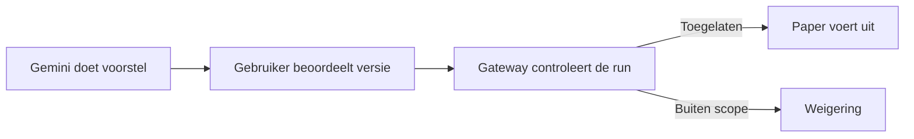

## 6. UI-inventaris

Workbench, Execution Insights, Host Activity en Settings zijn de hoofdnavigatie. De applicatieshell toont API/Paper-status, thema en Help. De browser weergave is Runlattice. Themavoorkeur is lokale browserstate. Console- en editorachtergronden hebben beide themawaarden.

| Scherm | Control en type | Gedrag | Backend / grens |
|---|---|---|---|
| Shell | navigatie, statusbadges | wisselt hoofdpagina, toont gezondheid | health en hoststatus lezen |
| Shell | thema, knop | licht/donker inclusief console | geen bevoegdheidswijziging |
| Shell | How to use, dialoog | bewijsbegrippen, workflows, ondersteunde profielen en grenzen | leesinformatie, Escape sluit |
| Workbench | Script Library, zoekveld en lijst | filtert en opent script | scriptgegevens lezen |
| Workbench | Assistant conversations, lijst | gesprek openen of starten | gesprekken lezen/maken |
| Workbench | Selected script runs, lijst | recente run selecteren | record lezen, volledige periodehistorie in Insights |
| Workbench | New script / naam / Language | start concept, kiest TS of JS | Save maakt/opdateert script |
| Workbench | Execution profile, select + info | kiest ID en legt per profiel grants uit | een keuze op zichzelf keurt niets goed |
| Workbench | Save changes | bewaart nieuwe snapshot van gewijzigde bestanden | versieroute, vorige versie blijft bestaan |
| Workbench | Run | start opgeslagen versie | POST executions, geen stilzwijgende review |
| Workbench | Execution status | verstuurd/actief/uitkomst, elapsed time | polling, geen percentage |
| Workbench | View in Execution Insights | opent specifieke run | kan buiten huidige periode staan |
| Workbench | What are the limits? | dialoog met registry, SDK-voorbeelden, quota, grenzen | registry lezen, geen runtimewijziging |
| Editor | file tabs, Project files | selecteert actief bestand, plus add/rename/delete en entrypoint | conceptbewerking tot Save |
| Editor | Script versions & availability | opgeslagen versies en bijbehorende status/metadata | versie lezen |
| Permissions | Review permissions | kiest expliciet ja/nee, opent review met versiecontext | schrijft review pas na bevestiging |
| Permissions | Export manifest JSON | lokaal downloaden | opgeslagen manifest, geen volledige uitvoer |
| Assistant | Open/Hide assistant | paneel naast editor of gestapeld op smalle schermen | weergave |
| Assistant | bericht, Send | stuurt tekst met opgeslagen context via API | Gemini/OpenAI/mock volgens configuratie |
| Assistant | proposal, bestandsdisclosures | bekijkt code, entrypoint en meerdere bestanden | voorstel blijft invoer |
| Assistant | Yes/No en bevestiging | expliciete keuzes inline, opslaan als draft | versie + review, geen Run |
| Evidence | uitkomst, duur, profiel, collectie, assessment | onderscheiden metadata en info-iconen | stored evidence |
| Evidence | execution path, Why this result? | vijf stappen, provenance, diagnose, uitklapbare details | afgeleid uit records |
| Evidence | Output, tab | stdout/stderr, copy, fout en links naar bronregels | scriptoutput blijft onbetrouwbare tekst |
| Evidence | Evidence, tab | permission observations, hostpad, security events | nul observaties verschilt van onbeschikbare collectie |
| Evidence | Runtime, tab | manifest en runtimevelden met bekende provenance | geen onafhankelijke attestation |
| Evidence | Timeline, tab | chronologie van beschikbare records | geen ontbrekende tijden invullen |
| Evidence | Export capability evidence JSON | download als authority bestaat | executionId, manifest, actualCalls |
| Insights | Period, select | Today, Last 24 hours, Last 7 days, Last 30 days, Custom range | serverquery, lokaal tijdzone-input |
| Insights | From/To, velden | custom begin inclusief en eind exclusief | maximaal 366 dagen |
| Insights | Provider, select | all, Docker of mock | queryfilter |
| Insights | Sort history, select | nieuwste, oudste, langste of kortste | server-side sortering |
| Insights | Refresh, prev/next | herlaadt en pageert in pagina's van 50 | offset maximaal 100.000 |
| Insights | periode-statistiek, disclosure | totaaltelling, uitkomsten, audit, advisory en duur | aggregaten over complete matchende query |
| Insights | Execution history, rijselectie | opent bewijs van die uitvoering | geen oud script/run-selectpaar, geen globale latest-100 afhankelijkheid voor periodequery |
| Host Activity | Server status, Refresh | Paper-connectie, spelersaantal, versies, heartbeat | read-only hoststatus |
| Host Activity | All/Players/Chat/Commands/System en Recent events | filtert events en kiest aantal | host-events lezen |
| Host Activity | activiteitsrij | details, ID's en provenance openen | Paper-bevestiging vereist opgeslagen correlatie |
| Settings | taal en contextnotices | wijzigt voorkeur, toont oorsprong en contextmetadata | projectcontext, niet Deno |
| Settings | netwerk, filesystem, subprocess, FFI | intentievlaggen voor assistent | geen permission flags |
| Settings | omgeving, console/plugin-intentie en overige voorkeuren | stuurt context en toont geconfigureerde metadata | geen command executor of runtime-override |
| Settings | save/reset en preview | bewaart/verwijdert overrides, laat effectieve context lezen | /api/project/settings en context-preview |

### CodeMirror en bestanden

`CodeEditor.tsx` gebruikt CodeMirror 6 met `state` 6.7.6, `view` 6.43.15, `lang-javascript` 6.2.5, `lang-json` 6.0.2 en packages voor search, commands, language en autocomplete. Ondersteunt JS, TS en JSON met highlighting, regelnummers, zoeken, undo/redo, inspringen en keyboardtabs. Dirty state bewaart bewerkte bestanden als concept. Een nieuwe versie is een bewuste Save. Bestandsnamen en entrypoint worden gevalideerd. Actieve tab en selectie zijn editorstate. Een foutlocatie kan in het betrokken bestand worden geopend. Zie `apps/web/package.json`, `CodeEditor.tsx` en `ScriptEditor.tsx`.

`ScriptProject` heeft `entrypoint` en `files: {path, content}[]`. Maximaal 20 bestanden, 256 KiB UTF-8 per bestand en 512 KiB totaal. Alleen relatieve .ts/.js/.json-paden, maximaal 160 tekens, geen traversal, verborgen of gereserveerde segmenten, case-insensitive duplicaten geweigerd. Entrypoint is een bestaand .ts- of .js-bestand. Normalisatie sorteert op pad. `bindingSource` serialiseert de genormaliseerde projectbundel als JSON voor SHA-256. Een aangepast hulpbestand bindt dus een andere snapshot. Legacy enkelvoudige bron blijft ondersteund.

Gemini kan een project met lokale helperbestanden en capability-aanvragen voorstellen. Bijvoorbeeld een eenmalige keuze van weer, twee spawn-aanroepen en een bericht vraagt drie afzonderlijke capability-ID's, waarvan spawn een toereikend quota vereist. API controleert vorm en scope. UI toont tabs en review voordat de gebruiker die versie draait. Lokale relatieve imports werken binnen de projectbundel. Het projectpad geeft Deno expliciet `--no-remote --no-npm` en biedt geen HTTP(S)-, npm- of jsr-dependencies of package-installatie. Het legacy-bronpad gebruikt die twee flags niet expliciet en blijft afhankelijk van de vaste netwerkscope en image. Een willekeurige bare import is geen ondersteunde projectdependency. Persistente listeners, klik/join-subscripties, daemons, Java-reflectie en onbeperkte I/O blijven buiten het one-shot model.

### Assistant en export

`providers/chat.ts`, `chat-instructions.ts` en `routes/conversations.ts` combineren bericht, projectcontext, registry en beperkingen. Server-side providerconfig gebruikt een sleutel als een echte provider geselecteerd is. Mock is gesimuleerd. Ontbrekende providerconfig wordt zichtbaar gemaakt. De inspectie las een opgeslagen Gemini-antwoord en startte geen nieuw extern gesprek. Conversaties en berichten worden opgeslagen. Een onbekende capability kan als unsupported verschijnen, maar is niet te autoriseren.

De JSON-export voor capability evidence bevat `extension`, `executionId`, `manifest` en `actualCalls`. Manifestexport is een tweede JSON-actie. Er is geen algemene PDF- of tekstexport met alle bestanden, stdout, runtime, classificaties en evidence. API/runner sanitizen credentialhoudende gegevens op de daarvoor bedoelde paden. Gebruikersinhoud verdient controle vóór delen. Zie `ExecutionCapabilities.tsx`, `CapabilityPermissions.tsx` en `execution-errors.ts`.

### Multi-file opslaan en uitvoeren

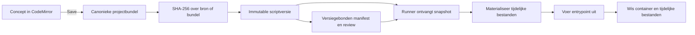

### UI-navigatie

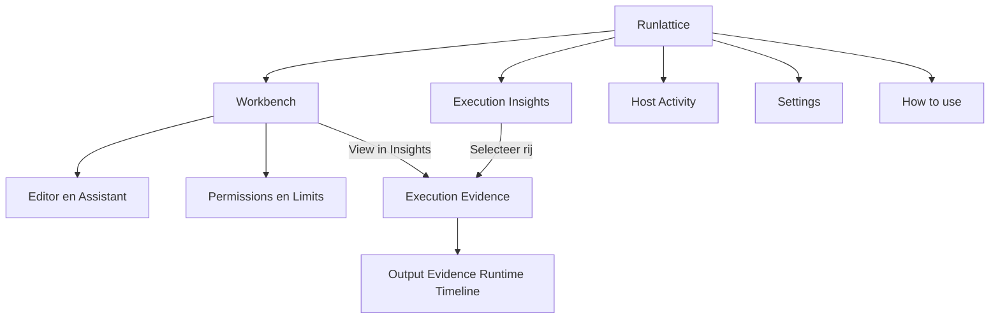

## 7. PostgreSQL-inventaris

| Tabel | Inhoud en relatie | Migratie |
|---|---|---|
| conversations, messages | gesprek 1:N berichten, role/content en metadata | 001 |
| scripts | scriptidentiteit, metadata, optionele conversation/source_message link | 001, 007, 008 |
| script_versions | script 1:N, bron/language, versionNumber en project JSONB | 001, 013 |
| executions | verwijst naar scriptversie, status/tijden/result JSONB | 001, 004 |
| execution_events | lifecycle-events per uitvoering | 001 |
| security_events | permissie- en hostobservaties met execution/trace-context | 001 |
| risk_assessments | classificatie, confidence, redenen, provider/schema/latency/failure | 001, 005, 006 |
| host_connections | heartbeat en status | 001 |
| host_events | zichtbare Paper/bridge-events | 001 |
| host_commands | type, payload, status en result, origin/correlation JSONB | 001, 009, 011, 013 |
| project_settings | opgeslagen overrides voor projectcontext | 003 |
| script_capability_manifests | één manifest per scriptversie, source_sha256, requests en waarschuwingen | 011 |
| script_capability_reviews | append-only reviews per manifest, approved en denied JSONB | 011, 012 |
| execution_capability_authorities | één immutable snapshot per uitvoering | 011 |

`013_script_projects.sql` bewaart bestanden in JSONB, zonder aparte file-tabel. De trigger blokkeert wijziging van opgeslagen bron, taal of project. `011_capability_manifests.sql` beschermt manifest, review en execution-authority tegen updates. De 012-migratie voegt deterministische reviewvolgorde toe. Legacy null-projecten blijven bruikbaar. Commandcorrelatie legt request/result aan uitvoering, manifest en call vast. Een unieke index beschermt manifestcall-ID's. De periodequery gebruikt een tijd/ID-index. De API is de schrijver voor deze gebruikers- en evidencegegevens. Collector-data gaan naar de debug-exporter en leven niet als collectorontvangst in deze tabellen.

Bronnen `apps/api/src/db/migrations/001_init.sql` tot `013_script_projects.sql`, `apps/api/src/repositories/{scripts,executions,execution-period,execution-history,risk}.ts`. Tabellen zijn geïnventariseerd uit actuele migraties. Er is geen export van live rijen gemaakt.

### Vereenvoudigd PostgreSQL-model

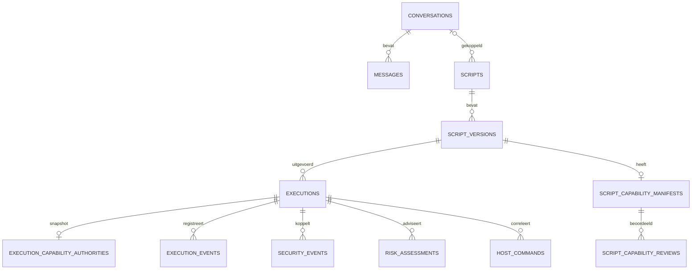

## 8. HTTP-inventaris

De mountpoints staan in `apps/api/src/main.ts`. Hieronder betekent lokaal dat de browserinterface van deze PoC geen algemene gebruikersauthenticatie toevoegt. Verborgen routes vereisen de vermelde servicecontext. Gebruik statuscodes op het juiste niveau, bijvoorbeeld 201 voor een gestart API-record en 429 bij volle supervisor.

| Methode en route | Aanroeper | Functie en trust |
|---|---|---|
| GET /health | Compose/web | service en DB-bereikbaarheid |
| GET /api/config/public | web | providerstatus, profielen en publiek model, zonder sleutel |
| GET /api/project/settings | web | base/effective/override settings, lokaal |
| PATCH /api/project/settings | web | gevalideerde overrides, lokaal |
| POST /api/project/settings/reset | web | reset overrides, lokaal |
| GET /api/project/settings/context-preview | web | effectieve context, lokaal |
| GET/POST /api/conversations | web | lijst en nieuw gesprek, lokaal |
| GET/POST /api/conversations/:id/messages | web | berichten lezen of providerpad starten, lokaal |
| GET/POST /api/scripts | web | lijst of draft opslaan, lokaal |
| GET/PATCH /api/scripts/:id | web | script/versiondata, metadata bijwerken |
| POST /api/scripts/:id/versions | web | nieuwe snapshot, lokaal |
| GET /api/scripts/capabilities/registry | web | actieve registry |
| GET /api/scripts/:id/versions/:versionId/manifest | web | opgeslagen authority-invoer lezen |
| POST /api/scripts/:id/versions/:versionId/manifest/reviews | web | gevalideerde append-only review |
| GET/POST /api/executions | web | legacy lijst of run beginnen |
| GET /api/executions/period | web | periodeaggregaten en gepagineerde data |
| GET /api/executions/history | web | server-side historie |
| GET /api/executions/:id | web | specifieke run |
| GET /api/executions/:id/events | client | SSE-route voor uitvoeringsstatus |
| GET /api/host/status en /api/host/events | web | Paper-status en records |
| POST /api/host/commands | lokaal | direct/debug enqueue uitgeschakeld, 403 |
| POST /api/host/bridge/heartbeat en /events | SecureBridge | Bridge-token |
| GET /api/host/bridge/commands/pending | SecureBridge | Bridge-token, claimt opdrachten |
| POST /api/host/bridge/commands/result | SecureBridge | Bridge-token, resultaatcorrelatie |
| GET /api/security/events en /risk-assessments | web | opgeslagen security-/advisorygegevens |
| GET /api/risk-assessments | web | alternatief advisory-list endpoint |
| POST /api/internal/host-commands en /host-events | Gateway | servicecredential en correlatie |
| GET /api/internal/capability-authority/:id | Gateway | versiegebonden snapshot, servicecredential |
| POST /api/internal/capability-commands | Gateway | queue, servicecredential en scopecontrole |
| GET /api/internal/capability-commands/:id | Gateway | status lezen, servicecredential |
| GET /api/research/evidence/:executionId | onderzoekstooling | gestructureerd bewijs lezen |
| GET /api/research/jev-preflight | onderzoekstooling | providerconfig/capability preflight |
| POST /api/research/jev-dry-run | onderzoekstooling | payloadpad valideren |
| POST /api/research/risk-classify | onderzoekstooling | separate classifierinterface, validatie van evidence |
| GET /health en POST /execute op runner:3100 | Compose/API | runner intern, gevalideerde job |
| GET /health en POST /v1/capabilities/:capability op gateway:3200 | Compose/SDK | uitvoeringstoken voor capabilitycall |
| POST /internal/sessions, /internal/sessions/bind en /internal/sessions/revoke op admin:3201 | runner | admincredential en netwerkgrens |

Bij samengestelde rijen gebruikt ieder verkort suffix hetzelfde prefix. Bestanden `apps/api/src/routes/*.ts`, `services/runner/src/main.ts`, `services/host-gateway/src/{main,manifest-calls}.ts`.

## 9. Configuratiereferentie

Bronnen `.env.example`, `compose.yaml`, `services/runner/src/config.ts`, `services/host-gateway/src/config.ts`, `apps/api/src/providers/chat.ts` en `apps/api/src/risk/jev-route.ts`. De tabel bevat defaults of voorbeelden. Er zijn geen live geheimen gelezen. Compose stuurt niet iedere gecommentarieerde variabele automatisch door. Voor geavanceerde overrides is gerichte serviceconfig nodig. Browser-API-URL is buildtijd; provider- en serviceconfig worden bij processtart gelezen. Settings-overrides zijn DB-applicatiecontext en vereisen geen nieuwe containerbuild.

### Stack en database

| Variabele | Vereist | Default | Doel | Geheim | Gebruikt door |
|---|---|---|---|---|---|
| `WEB_PORT` | nee | 5173 | hostpoort web | nee | Compose |
| `API_PORT` | nee | 3000 | hostpoort API; container op 3000 | nee | Compose/API |
| `VITE_API_URL` | bij afwijkende API-poort | http://localhost:3000 | browserdoel, buildtijd | nee | web |
| `POSTGRES_USER` | nee | poc | DB-gebruiker | nee | PostgreSQL/API |
| `POSTGRES_PASSWORD` | eigen waarde bij gedeeld gebruik | voorbeeldwaarde in .env.example | DB-authenticatie | ja | PostgreSQL/API |
| `POSTGRES_DB` | nee | research_poc | DB-naam | nee | PostgreSQL/API |
| `DATABASE_URL` | directe API-start | Compose construeert URL | DB-verbinding | ja | API |
| `PROJECT_CONFIG_DIR` | nee | image/projectconfig | locatie Assistant-projectcontext | nee | API |

### Host en Paper

| Variabele | Vereist | Default | Doel | Geheim | Gebruikt door |
|---|---|---|---|---|---|
| `BRIDGE_TOKEN` | ja | geen | Bridge-API-auth | ja | Paper/API |
| `HOST_GATEWAY_ADMIN_TOKEN` | ja | geen | sessiebeheer | ja | runner/Gateway |
| `HOST_GATEWAY_SERVICE_TOKEN` | ja | geen | internal API-auth | ja | Gateway/API |
| `HOST_GATEWAY_PORT` | nee | 3200 | capabilitylistener | nee | Gateway |
| `HOST_GATEWAY_ADMIN_BIND_HOST` | nee | host-gateway-admin in Compose | admin-interface | nee | Gateway |
| `API_BASE_URL` | nee | http://api:3000 in Compose | Gateway naar API | nee | Gateway |
| `BRIDGE_API_URL` | nee | http://api:3000 in Compose | Paper naar API | nee | Paper |
| `HOST_CHAT_BROADCAST_BUDGET` | nee | 5 | legacy quota | nee | Gateway |
| `HOST_CHAT_BROADCAST_MAX_LEN` | nee | 256 | legacy berichtlengte | nee | Gateway |
| `HOST_SESSION_TTL_MS` | nee | 40000 | standaard sessieduur | nee | Gateway |
| `HOST_SESSION_MAX_TTL_MS` | nee | 120000 | bovengrens sessieduur | nee | Gateway |
| `EULA` | voor Paper | FALSE in voorbeeld; Compose fallback TRUE | expliciete Minecraft-acceptatie | nee | Paper |
| `MC_VERSION` | nee | 1.21.1 | Minecraft-versie | nee | Paper |
| `MEMORY` | nee | 1G | Paper-geheugen, los van jobs | nee | Paper |
| `ONLINE_MODE` | nee | false | Paper-identiteitsmodus voor lokale PoC | nee | Paper |
| `MOTD` | nee | Research PoC Paper Server | serverbeschrijving | nee | Paper |
| `MAX_PLAYERS` | nee | 10 | spelerlimiet | nee | Paper |
| `VIEW_DISTANCE` | nee | 8 | view distance | nee | Paper |
| `MC_PORT` | nee | 25565 | gepubliceerde Minecraft-poort | nee | Compose |

### Assistant en Jev

| Variabele | Vereist | Default | Doel | Geheim | Gebruikt door |
|---|---|---|---|---|---|
| `CHAT_PROVIDER` | expliciet voor Assistant | mock in .env.example; Compose leeg indien oningesteld | mock/gemini/openai | nee | API |
| `GEMINI_API_KEY` | bij Gemini | geen | providercredential | ja | API |
| `GEMINI_MODEL` | nee | gemini-3.8-flash | Gemini-model | nee | API |
| `OPENAI_API_KEY` | bij OpenAI | geen | providercredential | ja | API |
| `OPENAI_MODEL` | nee | gpt-5.5 | OpenAI-model | nee | API |
| `RISK_ANALYZER` | nee | deterministic | mock/deterministic/jev/comparison | nee | API |
| `JEV_PROVIDER` | nee | typesafe in code; vercel in voorbeeld | providerprotocol | nee | API |
| `AI_GATEWAY_API_KEY` | bij Vercel | geen | gatewaycredential | ja | API |
| `TYPESAFE_API_KEY` | bij directe TypeSafe | geen | directe credential | ja | API |
| `JEV_API_KEY` | legacy alias | geen | directe credential | ja | API |
| `JEV_MODEL` | nee | providerafhankelijk; 1.14.0 | gekozen model | nee | API |
| `JEV_API_URL` | nee | providerroute | classificatie-endpoint override | nee | API |
| `JEV_MODELS_URL` | nee | providerroute | modellijst override | nee | API |
| `JEV_TIMEOUT_MS` | nee | 30000 | providerdeadline | nee | API |

### Uitvoering, gVisor en OTel

| Variabele | Vereist | Default | Doel | Geheim | Gebruikt door |
|---|---|---|---|---|---|
| `EXECUTION_PROVIDER` | nee | mock | mock of docker | nee | API |
| `EXECUTION_SUPERVISOR_URL / RUNNER_URL` | bij losse deployment | http://runner:3100 in Compose | runner endpoint; tweede legacy | nee | API |
| `RUNNER_PORT` | nee | 3100 | interne runnerpoort | nee | runner |
| `SANDBOX_IMAGE` | nee | research-poc-sandbox:local | jobimage | nee | runner |
| `SANDBOX_DENO_VERSION` | nee | 2.9.7 | verwachte Deno-versie | nee | runner |
| `SANDBOX_TIMEOUT_MS` | nee | 10000 | jobdeadline | nee | runner |
| `SANDBOX_MAX_ACTIVE` | nee | 2 | admissiecapaciteit | nee | runner |
| `SANDBOX_MAX_OUTPUT_BYTES` | nee | 1048576 | capturebudget | nee | runner |
| `SANDBOX_AUDIT_MAX_EVENTS / SANDBOX_AUDIT_MAX_BYTES` | nee | 200 / 65536 | auditbudget | nee | runner |
| `SANDBOX_CPUS / SANDBOX_MEMORY / SANDBOX_PIDS_LIMIT` | nee | 0.5 / 256m / 64 | resourcegrenzen | nee | runner |
| `SANDBOX_WORKSPACE_TMPFS / SANDBOX_TMP_TMPFS` | nee | 64m / 16m | tijdelijke filesystems | nee | runner |
| `SANDBOX_MAX_SOURCE_BYTES` | nee | 524288 | brongrootte | nee | runner |
| `SANDBOX_HOST_NETWORK` | nee | research-poc-sandbox-host | netwerk voor hostjobs | nee | runner |
| `SANDBOX_DOCKER_RUNTIME` | nee | leeg; Engine-default | eventueel runsc | nee | runner |
| `HOST_GATEWAY_URL / HOST_GATEWAY_SANDBOX_URL` | nee | interne admin- en capability-URL | gescheiden Gateway-doelen | nee | runner/SDK |
| `HOST_GATEWAY_NET_ALLOW` | nee | host-gateway:3200 | smalle Deno-netgrant | nee | runner/entrypoint |
| `OTEL_EXPORTER_OTLP_ENDPOINT` | nee | http://otel-collector:4318 in Compose | OTLP HTTP | nee | API |
| `OTEL_SERVICE_NAME` | nee | research-api in Compose | servicelabel | nee | API |
| `HOST_CAPABILITY_TOKEN` | door runtime | per sessie | korte execution-credential | ja | SDK/Gateway |
| `DENO_AUDIT_PERMISSIONS / DENO_DIR` | door runtime | tijdelijke jobpaden | audit en cache | nee | entrypoint |
| `SANDBOX_WORKDIR / SCRIPT_LANGUAGE / SCRIPT_PROJECT / PERMISSION_PROFILE` | door runtime | per vertrouwde jobconfig | workspace, parser, snapshot en grants | nee | runner/entrypoint |
| `SANDBOX_DEMO_VALUE` | door profiel | vaste demowaarde | begrensde env-demo | nee | runner |

## 10. Onderzoeksresultaten en verdediging

### Actueel adviespad

LOW staat voor geen gevonden escalatieregel in het beschikbare bewijs, REVIEW voor relevante signalen die beoordeling vragen en HIGH voor sterkere regels. Een gefaald script met complete collectie en LOW is mogelijk, bijvoorbeeld bij een gewone scriptfout zonder escalatiesignaal. Het omgekeerde kan ook bij opgevangen gedrag. Advies beslist niet over autorisatie.

De deterministische analyzer leest gestructureerde termination, permission observations en Host Gateway-evidence. `deterministic.ts` en `rules.ts` leveren vaste labels, score en reden/rule-ID's. Hoogste severity wint. R001 permissiegerelateerde procesfout, R004 geweigerde hostcall, R007 truncatie, R009 onverwachte read, R011 onverwachte env en R012 onverwachte netobservatie leiden tot REVIEW. R002 subprocess, R003 FFI, R005 herhaalde hostweigering/budget en R006 timeout leiden tot HIGH. Geen match betekent LOW binnen die regels. De actuele lokale analyzer is deterministisch. `comparison` behoudt het deterministische runtimepad. `jev` kan met passend account en configuratie als adviespad draaien. Fouten/time-outs leveren een afzonderlijke falende assessmentstatus.

Jev ontvangt een door de adapter geconstrueerde, begrensde representatie van gestructureerde evidence en policy. Geen bron, stdout, referentielabels of deterministisch antwoord als classificatie-invoer. Er is een providerkeuze TypeSafe/Vercel, met verschillende sleuteltypes. Standaardmodel per route `jev-1.14.0` respectievelijk `typesafe-ai/jev-1.14.0`, deadline standaard 30.000 ms. De adapter valideert onder meer klasse/distributie. Providerstatus, schema, latency en versies worden bij het resultaat bijgehouden waar beschikbaar. Modelvertrouwen is modeloutput en de weergegeven reden kan lokaal gegenereerd zijn. Zie `apps/api/src/risk/{jev,jev-input,jev-policy,jev-route,rules,deterministic}.ts`, `providers/risk.ts` en `services/advisory.ts`. De post-research capability-review staat los van beide analyzers.

### Phase 3 bevroren Jev-vergelijking

Vercel AI Gateway, pin `typesafe-ai/jev-1.14.0`. Na eerdere accountblokkade waren 3 smoke-, 125 primaire en 15 sensitiviteitscalls technisch geldig, 143 totaal. De 125 zijn 25 scenario's × vijf herhalingen. Geen retries of providerfouten in de afgeronde batch. Corpus bestaat uit 15 gesloten ontwikkelcases en 10 holdout-varianten.

| Partitie | Jev individueel | Jev modus | Deterministisch |
|---|---:|---:|---:|
| Development | 54/75 | 10/15 | 15/15 |
| Holdout | 30/50 | 6/10 | 9/10 |
| Totaal | 84/125 (67,2%) | 16/25 (64%) | 24/25 (96%) |

Beide volgen de referentie in 16 cases, deterministisch alleen in 8, Jev alleen in 0 en geen van beide in 1. Er zijn 23 unanieme cases. SCN-010 en SCN-013 splitsten 3 tegen 2. 121/125 antwoorden volgen de eigen casemodus (96,8%) en 238/250 antwoordparen stemmen overeen (95,2%). Primaire latency 180–535 ms, mediaan 230 ms, gemiddelde 246,232 ms en p95 397 ms. HOL-008 mist een vertrouwde observatie van de subprocesspoging. Beide zien LOW tegenover referentie REVIEW. Het ontbrekende signaal kan niet betrouwbaar uit de beschikbare records worden herleid. Jev was op dit corpus minder vaak in overeenstemming met de referenties en bood geen aangetoonde incrementele overeenstemmingswinst. Dit is geen algemene malwarebenchmark of generaliseerbare accuratesse.

Er was bovendien één bewaarde mislukte poging vóór het hervatten, HTTP 403 met `customer_verification_required`. Die kreeg geen risicoklasse en blijft buiten de successtatistiek. De sensitiviteitsproef gebruikte vijf cases met drie vooraf vastgelegde presentaties van dezelfde feiten. Vier cases hielden hun klasse. SCN-010 wisselde tussen REVIEW en HIGH. Eén call per vorm en bestaande variatie laten geen causale toeschrijving aan opmaak toe.

Bron `research-results/phase3-jev/resume-after-credit-2026-11-09/report.md` en `per-case-analysis.md`.

### Phase 4 bevroren runc/runsc-vergelijking

Native Docker binnen Ubuntu 24.04.2/WSL2, kernel 6.6.87.1, Docker 29.9.3, containerd 2.4.2, runc 1.5.2, runsc release-20261102.0 met systrap, Deno 2.9.7. De normale Desktop-stack bleef gescheiden. Per workload/runtimetype vijf gemeten pogingen, 100 totaal, plus 20 warm-ups en 10 runc-preflights. 85 completed, 10 geplande timeouts, 5 W8-fouten, nul ongeldige infrastructuurmetingen en nul reruns.

| Workload | Taak | Mediane duur runc / runsc ms | Ratio |
|---|---|---:|---:|
| W1 | JavaScript | 429 / 799 | 1,862× |
| W2 | TypeScript | 426 / 777 | 1,824× |
| W3 | begrensde read | 451 / 781 | 1,732× |
| W4 | begrensde env | 434 / 798 | 1,839× |
| W5 | opgevangen readweigering | 477 / 801 | 1,679× |
| W6 | verwachte timeout | 10289 / 10257 | 0,997×, geen overheadmaat |
| W7 | outputcap | 483 / 1113 | 2,304× |
| W8 | host-chat | runc 5/5 bevestigd, runsc 0/5 | geen vergelijkbare succesratio |
| W9 | zwaardere CPU | 521 / 844 | 1,620× |
| W10 | zwaardere toegestane I/O | 592 / 1548 | 2,615× |

Negen workloads voldeden in beide runtimes. W8 faalde bij DNS voor Gateway-hostnaam onder onveranderd runsc-netwerk. Een aparte direct-IP-healthdiagnose bevestigde dat die route bereikbaar kon zijn. Dat verandert de W8-score niet. Operationele runtime-attributie kwam uit host/daemonrecords en geselecteerde controls, geen cryptografische attestatie. gVisor biedt conceptueel een extra kernelabstractie, het experiment kwantificeerde geen beveiligingswinst en testte geen algemene ontsnappingsbestendigheid. Normale Compose laat de Engine-runtime standaard kiezen, runsc vereist opt-in en registratie. Bron `research-results/phase4-gvisor/2026-11-09T14-42-48Z-phase4bc-matched/report.md`, `compose.gvisor.yaml`, `docs/PHASE4A-NATIVE-WSL.md`.

### OpenTelemetry en Phase 5

`apps/api/src/telemetry/otel.ts` exporteert vanuit API een OTLP-reconstructie met execution- en sandbox-spans, timing en gerelateerde gebeurtenissen. Execution-, trace-, call- en command-ID's helpen records koppelen. De collector gebruikt een debug-exporter in `infrastructure/otel/otel-collector-config.yaml`. PostgreSQL staat los van ontvangst door de collector. Bij één geteste collectoruitval bleven Deno-beperking, Gateway-controle, Paper-effect en PostgreSQL-writes werken. Exportfout was zichtbaar en een latere trace kwam weer aan. Geen garantie op replay of volledig end-to-end geïnstrumenteerde Paper-spans. Phase 5 testte E1–E8 op Desktop/runc en een verse geïsoleerde reproductiestack. Bron `research-results/phase5-final-validation/2026-11-09T15-24-05Z/report.md`.

### Fasen en resultaten

| Fase | Doel en resultaat |
|---|---|
| 0 | Read-only begininventaris. Gedateerde uitgangssituatie onderscheiden van latere reparaties. |
| 1 / 1B | Vertrouwensgrenzen en evidence stabiliseren, gevolgd door gedeployde controle. Zie phase1- en phase1b-artifacts. |
| 2 | Admissie, lifecycle, herstel en afzonderlijk falend advies. Controls in control-matrix en failure-matrix. |
| 3 | Bevroren vergelijking van Jev en deterministische baseline. 24/25 tegenover 16/25 modaal. |
| 4 / 4A–C | Native WSL-runsc voorbereiden en matched workloads uitvoeren. 9/10 compatibel, DNS-verschil bij W8. |
| 5 | End-to-end bevestiging op normale stack, verse reproductie en één collectoruitval. |
| 6 | Demo-, documentatie- en regressieopruiming met 190 gedocumenteerde passes en een later gedeployde DB-check. |
| 7 | Claims, beperkingen en beantwoording aan het bewijs koppelen. |
| 7.5 | Professionele UI-polish, ontwerp en toegankelijkheid. |
| Later | Herstelde Gemini, evidence-UX, Runlattice, manifests, tien capabilities, multi-file en nieuwe Insights-periodeflow. |
| Nu | Read-only dossier van werkboom en draaiende lokale interface. |

### Onderzoeksvraag beantwoorden

**Detecteren.** Audit en hostrecords ondersteunen interpretatie van zichtbaar gedrag. HOL-008 toont dat geregistreerde evidence geen volledig beeld geeft. Jev kon ontbrekende observaties niet herstellen. De deterministische regels hadden in dit experiment hogere referentieovereenstemming.

**Isoleren.** Jobs draaien tijdelijk met beperkte Deno-grants, afzonderlijke containers en beperkte netwerken. Phase 4 valideerde specifieke operationele kenmerken en compatibiliteit van een extra runsc-grens. De architectuur motiveert die grens. Algemene ontsnappingsbestendigheid werd niet aangetoond.

**Beperken.** Timeout, output, CPU/geheugen/PID-configuratie, lokale capaciteit en de geautoriseerde hostinterface begrenzen verschillende effecten. Phase 5 demonstreerde reële weigering en Paper-bevestiging binnen het historische chatpad. De huidige tien-capability-interface heeft eigen post-research validaties.

**Defense-in-depth.** De collector mag wegvallen zonder de toegangscontrole over te nemen. Een bereikbare Gateway controleert alsnog bevoegdheid. Een onjuiste of ontbrekende classificatie kan de run of goedkeuring niet omzetten.

**Academisch.** De gecontroleerde waarnemingen ondersteunen het vermogen van de architectuur om geselecteerde effecten te isoleren en begrenzen, en waargenomen gedrag te interpreteren. De mate van detectie hangt af van instrumentatiedekking, de gebruikte labels, de taakverdeling en de geteste omgeving. De onderzochte runsc-configuratie levert bewijs voor compatibiliteits- en prestatieverschillen, geen gemeten universele beveiligingswinst.

**Eenvoudig.** We kunnen scripts tijdelijk en met weinig bevoegdheden uitvoeren. We kunnen terugzien wat de instrumentatie registreerde en Paper-acties controleren. Sommige pogingen blijven onzichtbaar en de risicolabels zijn alleen advies.

**Mondeling, circa twintig seconden.** “We voeren scripts uit in tijdelijke containers met vaste rechten. Minecraft-acties gaan door een aparte controle en Paper meldt het resultaat terug. De logs tonen een deel van het gedrag. In onze 25 testcases volgden vaste regels de referenties vaker dan Jev.”

### Getallen en claims

| Getal | Onthoud waarom |
|---|---|
| 24/25, 16/25, 84/125 | deterministisch, Jev-casemodus, individuele Jev-calls tegen referentie |
| 5, 23/25 | herhalingen per case, unanieme cases |
| 9/10, 100 | compatibele workloads en gemeten runs |
| 1,62–2,62× | runsc-medianen voor vergelijkbare succesvolle niet-timeout workloads |
| 2, 10 s, 256 MiB, 64 | standaard actieve jobs, tijdgrens, geheugen en PIDs |
| 10, 12 | actuele capabilities en totale manifestcallgrens |

Veilige claims zijn dat de geselecteerde proeven dit gedrag aantoonden, dat de Gateway een aanvraag buiten scope weigert, en dat bij de geteste collectoruitval handhaving bleef werken. Vermijd “onmogelijk te ontsnappen”, “Jev detecteert malware”, “complete audit ziet alles”, “gVisor is X procent veiliger” en “alle nieuwe capabilities zijn in Phase 3 of 4 getest”.

## 11. Implementatie tegenover bevroren onderzoek

| Feature | Bevroren onderzoek | Empirische status | Actueel | Later toegevoegd |
|---|---|---|---|---|
| Deno-permissies | Ja | geselecteerde profielen/observaties | Ja | vijfde profiel later |
| Docker-limieten en capaciteit | Ja | geselecteerde caps, timeout en herstel | Ja | nee |
| Host Gateway en chat.broadcast | Ja | echte Paper-bevestiging en begrenzing | Ja | uitgebreide modus later |
| Tien capabilities, player/world API | Nee | post-research proeven, eigen scope | Ja | ja |
| Per-script manifests | Nee | post-research versie- en reviewtests | Ja | ja |
| Multi-file projects | Nee | post-research editor/runtimevalidatie | Ja | ja |
| Gemini Assistant | buiten kernexperimenten | post-research herstel en providerchecks | Ja | huidige integratie gepolijst |
| Deterministische classifier | Ja | 24/25 op frozen cases | Ja, actief | nee |
| Jev | Ja | gemeten in Phase 3 | Ja, optioneel | nee |
| gVisor/runsc | Ja | native matched experiment | Opt-in | nee |
| OpenTelemetry | Ja | echte ontvangst en één uitvalscenario | Ja | nee |
| Execution Insights | huidige periodeflow niet bevroren | frontend en API-regressie | Ja | huidige flow later |
| Capability evidence export | Nee | post-research browserverificatie | Ja | ja |
| CodeMirror multi-file UX | Nee | post-research tests | Ja | ja |

Historische bewering “alleen chat.broadcast” geldt voor de bevroren hostscope. De actuele tien-capability-registry breidt die scope uit. Gebruik de huidige code bij vragen over de productdemo en de bijbehorende bevroren rapporten bij vragen over resultaten.

## 12. Beperkingen, verificatiegrenzen en toekomstwerk

| Rang | Type | Beperking en gevolg | Mogelijke vervolgstap |
|---|---|---|---|
| 1 | Onderzoek | Corpus klein en researcher-designed. Overeenstemming geldt binnen deze referenties | onafhankelijke cases en labeling |
| 2 | Onderzoek | Audit kan gedrag missen. HOL-008 illustreert het verwachte verschil tussen instrumentatie en werkelijkheid | bredere getoetste instrumentatie |
| 3 | Onderzoek | Eén Jev-combinatie en kort meetvenster | aparte vooraf geregistreerde replicatie |
| 4 | Onderzoek | Eén WSL2-opstelling en tien workloads. Overhead varieert per taak | meerdere hosts en workloads |
| 5 | Onderzoek | W8 DNS incompatibel in frozen runsc-opstelling | afzonderlijke compatibiliteitsstudie |
| 6 | Onderzoek | Geselecteerde controls, geen bewijs tegen alle ontsnappingen | gericht en gecontroleerd assurance-onderzoek |
| 7 | Product | Lokale PoC-identiteit en gepubliceerde poorten, geen productie-tenantmodel | echte identity, netwerk- en autorisatiemodel |
| 8 | Product | One-shot, beperkte registry, geen persistente jobs | alleen met apart lifecycle- en autorisatieontwerp |
| 9 | Product | Collector-export best effort, geen duurzame tracebackend | duurzame export en meetbare delivery |
| 10 | Product | Twee jobs per runner en geen queue. Bij onzekere cleanup tijdelijk minder capaciteit | hersteltelemetrie en expliciet schaalontwerp |

De inspectie heeft geen nieuwe Gemini/Jev-call, Minecraft-handeling, timeoutjob of runsc-experiment gestart. Online-player-gedrag en nieuwe fysieke Paper-effecten zijn daarom niet opnieuw bevestigd. Het actieve-jobbeeld komt uit de vorige echte smoke van dezelfde lokale app. De live browser gebruikte bestaande records en een desktopbrowser. Compose/public config werden bij de eerste inspectie gelezen. Bij een latere controle draaiden de services niet meer en weigerde poort 13000 verbinding. De actuele migraties zijn geïnspecteerd, live cataloguscontrole en runner-proceswaarden waren toen niet meer verifieerbaar. Exacte image/bron-equivalentie voor iedere service en fysieke mobiele hardware zijn niet opnieuw geattesteerd.

## 13. Demonstratieplan voor 5–10 minuten

Gebruik een schermopname of de opgeslagen runs als hoofdroute. Er is geen extra speler nodig. Dit plan beschrijft handelingen voor een latere demonstratie, de dossierinspectie voert ze niet uit.

| Tijd | Actie | Vertel | Verwacht en fallback |
|---|---|---|---|
| 0:00–0:45 | Workbench en scriptbibliotheek | Dit is de invoer- en uitvoerwerkbank | overzicht, anders screenshot |
| 0:45–1:30 | open bestaand console-script en runrecord | Normaal profiel heeft geen extra grants | output 4 bij fixture, anders bestaand record |
| 1:30–2:30 | open opgeslagen failed/timeout detail | Scheid process outcome, evidence en advisory | diagnose en stdout, anders timeoutcapture |
| 2:30–3:40 | open opgeslagen Assistant-proposal en bestands-tabs | Gemini schrijft voorstel, gebruiker beoordeelt versie | inline keuzes, anders screenshot |
| 3:40–4:45 | open review en sluit zonder opslaan | Toon profieltransport en aparte authority | neutrale review, anders opgeslagen review |
| 4:45–6:00 | open bevestigde hostrun en Host Activity | Paper-resultaat geeft bevestiging na Gateway | opgeslagen broadcast, geen online speler nodig |
| 6:00–7:00 | open Insights, kies periode en selecteer run | Query telt alle passende pagina's | tabel en statistiek, anders capture |
| 7:00–8:00 | open What are the limits? | One-shot, vaste registry en quota | dialoog, sluit met samenvatting van 24/25, 16/25 en 9/10 |

Als een nieuwe Minecraft-actie gewenst is, kies een vooraf gecontroleerde serverbrede demo op een eigen testserver. Gebruik voor de presentatie bij voorkeur een eerder Paper-bevestigd record zodat providertoegang, netwerk en online spelers geen afhankelijkheden zijn.

## 14. Vragen voor de mondelinge verdediging

Koppel antwoorden aan de hoofdstukken over uitvoering, security, registry, onderzoek en UI. Iedere vraag gaat over dit project.

### Architectuur

1. **Wat is de kleinste uitleg van Runlattice?** Een werkbank voor tijdelijke, begrensde scripts die alleen via benoemde bevoegdheden Minecraft kunnen aanroepen.
2. **Waarom een aparte runner?** Daar ligt de job-lifecycle en Docker-socket. De API beheert verzoeken en opslag.
3. **Waarom is Paper geen onderdeel van de sandbox?** De hostwereld blijft buiten de levensduur en bevoegdheden van het script.
4. **Wat is het verschil tussen API en Gateway?** API beheert productrecords. Gateway controleert hostcalls en gebruikt het interne API-pad om ze te queuen.
5. **Is Azure nodig?** Nee. Compose kan lokaal starten en mockproviders zijn beschikbaar.

### Beveiliging

6. **Kan de browser Docker-flags kiezen?** Nee. De route valideert een profiel-ID en de runner bouwt vaste flags.
7. **Kan Gemini een bevoegdheid toestaan?** Nee. Gemini doet een voorstel. Een review van de versie levert de invoer voor Gateway-autoriteit.
8. **Is een bereikbaar Gateway-adres voldoende?** Nee. De sessie, het peerverband, de capability, de argumenten en quota blijven gecontroleerd.
9. **Wat laat één collectoruitval zien?** In de geteste situatie bleven uitvoering, autorisatie en duurzame DB-evidence werken.
10. **Is de API productie-authenticated?** Er zijn servicecredentials voor technische paden. Er is geen algemeen productiegebruikersmodel.

### Deno

11. **Wat krijgt none?** Geen extra Deno-runtimegrants en geen Docker-netwerk.
12. **Wat geeft read-fixture?** Read-grant voor /fixtures.
13. **Kan env-demo API-secrets lezen?** Het profiel geeft alleen SANDBOX_DEMO_VALUE.
14. **Wat betekent een native permissieobservatie?** Een geregistreerde access/check, zonder zelfstandig allow/deny-resultaat.
15. **Waarom werkt import uit host alleen bij hostprofielen?** Daar levert de trusted importmap de bare specifier en het profiel geeft smal transport.

### Docker

16. **Welke standaard joblimieten onthoud je?** 10 s wall-time, 0,5 CPU, 256 MiB geheugen, 64 PIDs en 1 MiB capture.
17. **Waarom read-only root met tmpfs?** De job kan op voorspelbare tijdelijke locaties werken terwijl de image niet blijvend wijzigt.
18. **Wat gebeurt er bij een derde actieve job?** De runner weigert met 429 bij de standaardcapaciteit van twee en heeft geen wachtrij.
19. **Waarom kan capaciteit bezet blijven na een fout?** Zolang cleanup onzeker is, wil de runner geen slot onterecht opnieuw toekennen.
20. **Waarom toont timeout toch stdout?** De output is tijdens de job al deels gecaptured. De auditafsluiting kan nog ontbreken.

### gVisor

21. **Wat is runsc?** De optionele gVisor OCI-runtime.
22. **Was de normale demo runsc?** De normale Docker Desktop-stack gebruikt de Engine-default; het gematchte runsc-experiment draaide apart.
23. **Waarom telde W6 als compatibel?** De vooropgestelde taak was gecontroleerde timeout en cleanup.
24. **Wat faalde bij W8?** De Gateway-hostnaam resolveerde niet onder het gemeten runsc-netwerk.
25. **Bewijst direct-IP dat W8 slaagde?** Nee. Een afzonderlijke healthdiagnose beperkte de mogelijke oorzaak. De gemeten W8-uitkomst bleef ongewijzigd.
26. **Was runsc aantoonbaar veiliger?** Het onderzoek toonde geselecteerde controls en compatibiliteit, zonder universele effectiviteitsmaat.

### Gateway en manifests

27. **Waar worden requests opgeslagen?** In script_capability_manifests, gekoppeld aan script_versions.
28. **Kan een review worden herschreven?** De database-update-trigger beschermt de geschiedenis. Een nieuwe review wordt toegevoegd.
29. **Wat doet partial approval?** Alleen de gekozen subset komt in de execution-authority.
30. **Wat gebeurt met de review na wijziging van één helper?** De canonieke bundel en hash wijzigen bij Save. De nieuwe versie heeft een eigen review.
31. **Wat is de totale manifestcallgrens?** 12 per sessie, daarnaast geldt een per-capabilitygrens.
32. **Is QUEUED hetzelfde als Paper-succes?** QUEUED bevestigt enqueue. Een gekoppeld Paper-resultaat is het bewijs voor CONFIRMED.
33. **Waarom staan sommige posities niet toe?** De eerste wereld, spawnzone en geladen chunks begrenzen wereldimpact.
34. **Kan world.setBlock bedrock aanpassen?** CommandExecutor beschermt bedrock en TileState.

### Jev en regels

35. **Wat geeft de deterministische analyzer terug?** Klasse, score en rule-gebaseerde redenen voor bekende evidence.
36. **Wat wint als REVIEW en HIGH beide matchen?** HIGH heeft voorrang.
37. **Kan FAILED tegelijk LOW zijn?** Ja. Procesfout en risicoklasse beantwoorden verschillende vragen.
38. **Welke modelpin is gebruikt?** typesafe-ai/jev-1.14.0 via Vercel.
39. **Waarom tellen 125 calls als 25 scenario's?** Elke case kreeg vijf herhaalde classificaties.
40. **Wat was het resultaat?** Deterministisch 24/25, Jev 16/25 per casemodus en 84/125 per afzonderlijke call.
41. **Wat is HOL-008?** De subprocesspoging ontbreekt in vertrouwde observaties. Beide analyzers labelden LOW bij REVIEW-referentie.
42. **Kon Jev redenen teruggeven?** De adapter ontving een getypeerde keuze en kansen. Getoonde evidence-redenen konden lokaal ontstaan.

### Telemetry en database

43. **Welke service emit de hoofdtrace?** De API reconstrueert OTLP-spans op basis van vertrouwde records.
44. **Is een opgeslagen execution bewijs van collectorontvangst?** Nee. Daarvoor is afzonderlijke export/collectorobservatie nodig.
45. **Is er een duurzame tracebackend?** De huidige collectorconfig gebruikt debug-export. PostgreSQL bewaart applicatie-evidence.
46. **Waar staan projectbestanden?** JSONB project in script_versions, met legacy ondersteuning.
47. **Wat bindt een hostresultaat aan een run?** Execution-, trace-, call- en commandcorrelatie waar beschikbaar.

### Editor en product

48. **Welke bestanden zijn toegestaan?** Maximaal twintig .ts-, .js- of .json-bestanden binnen de bundellimieten.
49. **Is JSON een entrypoint?** Nee. Entrypoint is bestaand .ts of .js.
50. **Krijgt een actieve run een procentmeter?** Nee. De interface gebruikt bekende API-statussen en elapsed time.
51. **Waarom werkt een opgeslagen run buiten de periode?** Een directe Workbench-link kiest een execution-ID apart van het periodefilter.
52. **Wat staat in capability export?** Execution-ID, authority-manifest en verzamelde hostcalls.
53. **Is Settings netwerkintentie een permission?** Nee. Het is context voor voorstellen.

### Methodologie en toekomst

54. **Waarom verschilt reproduceerbaarheid van referentieovereenstemming?** Een model kan consistent hetzelfde afwijkende label geven.
55. **Wat zegt 9/10 over andere servers?** Het is een resultaat voor de tien bevroren workloads en opstelling.
56. **Waarom zijn nieuwe features niet bij frozen onderzoek geteld?** Ze zijn later toegevoegd en hebben eigen post-research validatie.
57. **Wat zou je eerst verbeteren voor gedeeld gebruik?** Gebruikersidentiteit, autorisatie en netwerkexposure krijgen prioriteit.
58. **Hoe verbeter je empirische externe validiteit?** Meer diverse scenario's, onafhankelijke labels en meerdere hostopstellingen.
59. **Hoe leg je de dependency-audit eerlijk uit?** De actuele npm-scan vindt dev-problemen. De productie-only frontendscan is geen audit van alle services.

## 15. Begrippenlijst

| Term | Betekenis in Runlattice |
|---|---|
| Sandbox | tijdelijke jobomgeving met Deno en Docker |
| Untrusted code | bron van gebruiker of assistant die alleen binnen de job wordt uitgevoerd |
| Defense-in-depth | onafhankelijke grenzen voor proces, resourcegebruik en hosteffecten |
| Deno permission | runtimegrant voor een specifiek type en domein |
| Container | geïsoleerde Docker-job met eigen lifecycle |
| runc | normale OCI-runtime in de onderzochte Desktop-opstelling |
| runsc | optionele gVisor-runtime |
| gVisor | extra syscall- en kernelabstractie tussen job en Linux-host |
| Capability | expliciet benoemde Minecraft-operatie met schema en quota |
| Capability manifest | opgeslagen aanvraagset voor één versie en bronhash |
| Host Gateway | service die hostauthority controleert vóór enqueue |
| SecureBridge | Java-plugin die beperkte Paper-opdrachten uitvoert en bevestigt |
| Evidence | beschikbare proces-, permissie- en hostrecords |
| Observation | geregistreerde access/check, zonder per-event allow/deny-betekenis |
| Provenance | herkomst en bewijskracht van een UI-feit |
| Observed | ondersteund door een vertrouwd vastgelegd record |
| Inferred | afgeleid via bekende correlatie |
| Advisory | afzonderlijke risicointerpretatie zonder uitvoerbevoegdheid |
| Deterministic | gelijke evidence en rules geven dezelfde class |
| Jev | modelgebaseerde optionele evidenceclassificatie |
| OpenTelemetry | telemetrystructuur voor spans en reconstructie |
| OTLP | protocol voor export naar de collector |
| Trace / span | gekoppelde observaties / één onderdeel met timing |
| Correlatie | verbinden van execution, trace, call en command IDs |
| Timeout | runner stopt job bij wall-timegrens |
| OOM | out-of-memory, een resourceprobleem, niet hetzelfde als timeout |
| Fail-closed | weigering of behoud van blokkade bij ontbrekende geldige autorisatie of onzekere cleanup |

## 16. Dependency-audit

Op 11 november 2026 is `npm audit --json` op het actuele frontendlockfile uitgevoerd, plus `npm audit --omit=dev --json`. Beide uitkomsten zijn opgeslagen in `inspection/`. Het volledige npm-resultaat telt 2 critical, 1 high, 3 moderate. De productie-only scan meldt nul. De totalen tellen pakketten en hun hoogste afgeleide severity, geen afzonderlijke CVE's.

| Pakket | Ernst en keten | Advisory | Auditvoorstel |
|---|---|---|---|
| vitest | critical, direct dev | GHSA-5xrq-8626-4rwp | Vitest 5.1.0, major |
| tinypool | critical, transitief via Vitest | GHSA-5gmw-xhrv-c9v3 en GHSA-85c8-ppgw-ccpr | Vitest 5.1.0, major |
| vite | high, direct dev | GHSA-587h-7wmj-h5pm | Vite 8.3.8, major |
| @vitest/mocker | moderate, via Vitest | GHSA-82fw-gwwq-j7x9 en GHSA-qxg6-89mg-rqv8 | onderdeel van Vitest-update |
| vite-node | moderate, via Vitest/Vite | npm-erfenis van Vite-issues | onderdeel van Vitest-update |
| esbuild | moderate, via Vite | GHSA-67mh-4wv8-2f99 | onderdeel van Vite-update |

De huidige productiewebimage serveert statische output met nginx. Vite/Vitest-ontwikkelservers en de Vitest-workerpool zijn geen webserverprocessen in die image. De findings blijven relevant voor development en build/testomgevingen. Nul npm-production findings is geen scan van Deno, de containerbasis, Java, Paper of de gehele stack. Auditvoorstellen zijn geregistreerd, geen upgrades uitgevoerd.

Bronnen `apps/web/package-lock.json`, `apps/web/Dockerfile`, `inspection/npm-audit-current.json`, `inspection/npm-audit-production.json`.

## 17. Issues discovered during dossier inspection

| Ernst | Bevinding | Onderbouwing |
|---|---|---|
| IMPORTANT | De lokale PoC publiceert browser/API/Paper-poorten op alle interfaces en heeft geen algemene gebruikersauthenticatie. | compose-status, compose.yaml en API-route-inventaris |
| IMPORTANT | npm meldt twee critical en één high in dev-tooling. | actuele audit, zie dependency-findings.md |
| IMPORTANT | runsc W8 DNS-verschil beperkt de bevroren host-chatcompatibiliteit. | Phase 4B/C, 0/5 bevestigde runsc-runs |
| MINOR | Drafts leven in de browserwerkstroom. Een reload kan een niet-opgeslagen concept verliezen. | ScriptEditor/App conceptstate en advanced-platform rapport |
| MINOR | Volledige evidence-export bestaat alleen als beperkte capability-JSON. | ExecutionCapabilities en CapabilityPermissions |
| MINOR | Sommige historische stukken spreken over alleen chat.broadcast. Voor het huidige product is dat te beperkt. | Phase 5-scope tegenover actuele registry |
| COSMETIC | Op smalle schermen vraagt de gestapelde bibliotheek extra scroll tot de editor. | after-workbench-mobile.png |

Geen code, instellingen of researchresultaten aangepast tijdens de inspectie.

## 18. Bronindex en verificatiestatus

| Onderwerp | Primaire bron |
|---|---|
| UI en routes | apps/web/src/App.tsx, components/ScriptEditor.tsx, ChatPanel.tsx, ExecutionDetail.tsx, ExecutionInsights.tsx, ServerInfoPanel.tsx, ProjectSettingsPanel.tsx, Help/Limits in componenten |
| Versie en bundel | packages/contracts/src/script-project.ts, apps/api/src/routes/scripts.ts, repositories/scripts.ts, 013_script_projects.sql |
| Capability-grens | packages/contracts/src/capabilities.ts, services/host-gateway/src/main.ts, manifest-calls.ts, sessions.ts |
| Versieauthority en persistentie | apps/api/src/routes/internal.ts, 011_capability_manifests.sql, 012_capability_review_order.sql |
| Uitvoering | apps/api/src/services/mock-execution.ts, providers/execution.ts, services/runner/src/docker.ts, admission.ts, permissions.ts |
| Audit en presentatie | services/runner/src/audit-collection.ts, packages/contracts/src/audit-collection.ts, apps/web/src/execution-ux.ts, execution-errors.ts |
| Advies en Jev | apps/api/src/risk/rules.ts, deterministic.ts, jev.ts, jev-input.ts, jev-route.ts, config/jev-risk-policy-v2.md |
| Paper | minecraft/bridge/src/main/java/be/research/securebridge/CommandExecutor.java, SecureBridgePlugin.java, HttpPollingBridgeTransport.java |
| Telemetry | apps/api/src/telemetry/otel.ts, infrastructure/otel/otel-collector-config.yaml |
| Runtime en config | compose.yaml, compose.gvisor.yaml, .env.example, inspection/public-config.json |
| Onderzoek | Phase 3 hervat rapport, Phase 4B/C, Phase 5 en Phase 7 in research-results |

### Testinventaris en bekende resultaten

- Frontend `apps/web/src/*.test.tsx`. Laatste polish 155/155 in twaalf testbestanden, inclusief editor, toestemming, evidence en datumflow. Typecheck en build apart geslaagd.
- API `apps/api/tests/*_test.ts`. Provider, regels, context, versieauthority, bridge-auth, execution history en evidence. DB-suites vereisen opt-in/testdatabase en horen niet automatisch bij unit-tellingen.
- Runner `services/runner/tests/*_test.ts`. Validatie, limieten, capture, audit, cleanup en credentialafscherming. Docker-integration vereist geschikte Engine.
- Gateway `services/host-gateway/tests/*_test.ts`. Sessions, TTL/boundaries, schemas en autorisatie.
- Shared contracts `packages/contracts/tests/platform_test.ts`. Project- en registryvorm, Java-resource-consistentie.
- SecureBridge `minecraft/bridge/src/test`. JUnit/Gradle, argumenten en protocol. Paper-runtime-effecten afzonderlijk.
- Phase 5 rapporteert 217 passes en één lokale guarded DB-skip die gedeployed slaagde. Phase 6 rapporteert 190 passes en één guarded DB-skip die afzonderlijk slaagde. Tijdens het dossier zijn geen runtimesuites herhaald.

| Suite | Laatste beschikbare post-research telling | Reikwijdte |
|---|---:|---|
| Frontend | 155 | final visual polish |
| API | 153 geslaagd, 4 guarded skips | advanced-script-platform |
| Runner | 54 | advanced-script-platform |
| Gateway | 33 | advanced-script-platform |
| PostgreSQL | 4 | afzonderlijke uitvoering van de guarded API-tests |
| Docker | 27 | advanced-script-platform |
| Shared contracts | 3 | advanced-script-platform |
| Java | 19 | advanced-script-platform |

Bronnen `research-results/manual-polish/advanced-script-platform/2026-11-10T18-09-51Z/report.md` en `research-results/manual-polish/final-visual-polish/2026-11-11T14-56-34Z/tests.md`.

## 19. Aanvullende bronverificatie

### Lifecycle, status en runtime

`ExecutionStatus` in `apps/web/src/types.ts` bevat `queued`, `validating`, `analysing`, `running`, `completed`, `blocked`, `failed`, `terminated`. De benaming `queued` hoort bij het persistente API-startrecord en betekent geen algemene schedulerqueue voor volle runner-slots. `ExecutionService.runPipeline` volgt na de aanmaak van dat record. De UI kan lokaal al “Sending” tonen vóór het API-record bestaat. Verstreken tijd is in dat stadium client-observatie. Een proces dat terugkeert kan een ander resultaat, andere collectie en nog geen assessment hebben. De stepper projecteert die losse feiten.

De runner vraagt TTL gelijk aan sandbox-timeout plus 30 seconden. Bij de standaardtimeout is dat 40 seconden. Configuratie noemt daarnaast een Gateway-default en maximale TTL. `SecureBridgePlugin.java` plant heartbeat na 40 ticks en elke 100 ticks, polling na 60 ticks en elke 40 ticks. Minecraft-ticks zijn geen gegarandeerde wall-clock-intervallen. Poll/result-verkeer is asynchroon. Paper voert de wereldactie op de serverthread uit. Getagde demo-entiteiten krijgen opruiming na 1.200 ticks. De hostgame kan gedrag beperken, bijvoorbeeld door `DIFFICULTY: peaceful`.

De tijdens inspectie uitgelezen Engine-default was `runc`. De Compose-config laat de sandbox runtime leeg tenzij expliciet geconfigureerd. De dossierinspectie maakte geen nieuwe job aan om die keuze onafhankelijk te observeren.

### Insights en Settings

De periodedisclosure bevat `Completed`, `Advisory LOW`, `Advisory REVIEW`, `Advisory HIGH`, `Failed`, `Terminated`, `Complete evidence` en `Average duration`. De actieve periodeview gebruikt deze numerieke definitielijst. De totale telling omvat alle passende statussen, ook wanneer geen afzonderlijke statistiek voor die status bestaat. Gemiddelde duur gebruikt alleen records met duur. De API accepteert 1–200 resultaten per page, de UI vraagt 50. Begin is inclusief en einde exclusief. `Today` gebruikt lokale kalendergrenzen. Een paginawissel gebruikt dezelfde querytijdgrenzen. Er is geen gegarandeerde transactiesnapshot over alle pagina's bij gelijktijdige databasewijzigingen.

`ProjectSettingsPanel.tsx` gebruikt een debounced PATCH voor bewerkbare voorkeuren, aparte resetbevestiging en previews voor effectieve context. Bronwaarden uit `config/project-spec.yaml` beschrijven host, bridge, scripting, security en project. Bewerking van taal en intentievlaggen werkt via `project_settings`. Status van live Paper komt uit Host Activity. `project.executionEnforcement: mocked` is als legacy contextmetadata gemarkeerd. Het live publieke configendpoint meldde `docker`; voor de werkelijke provider is dat het relevante runtimegegeven. `arbitraryConsoleCommands` en `directMinecraftPluginGeneration` zijn contextintentie. Een optionele voorkeur verandert de vaste Paper-enum of Deno-grants niet.

### Andere opvallende verificatiepunten

- De werkende runtime gebruikt oude en nieuwe records naast elkaar. `legacy_unknown` is legitieme expliciete onzekerheid.
- Directe hostcommando's zijn via `POST /api/host/commands` bewust uitgeschakeld. De Bridge mag alleen de beschreven servicepaden gebruiken.
- De registry- en materialisatiegrenzen zijn op meerdere plaatsen afgedwongen. `packages/contracts/tests/platform_test.ts` bewaakt ook gelijkheid van het gegenereerde Java-resourcebestand.
- Exacte serviceversies zijn waar mogelijk uit Compose, buildbestanden of publieke status gehaald. Een latere runtimecheck kon live tabelnamen of jobproceswaarden niet verzamelen nadat de stack gestopt was.
- Bevroren integriteit vergeleken met de eerder opgeslagen baseline. Alle 1.800 SHA-256-waarden matchen. Git-status buiten de dossiermap hield dezelfde aantallen als bij aanvang.

## 20. Presentatie-assets

Zie [de assetindex](presentation-assets/README.md) voor 22 echte browseropnamen en 15 deterministische diagrammen. Voor een mondelinge verdediging zijn de verkorte architectuur-, uitvoerings- en goedkeuringsdiagrammen geschikt. Workbench, de profieltooltip, de opgeslagen timeout en het Paper-bevestigde execution-record illustreren de kern.
